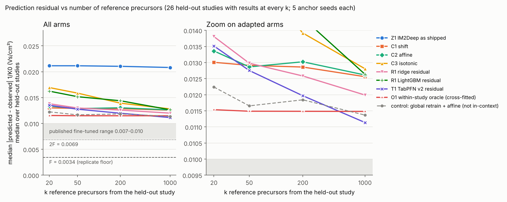

**NO-GO: do not build the meta-trained in-context ion mobility adapter.** On 34,507 precursors shared by at least 4 of 25 timsTOF studies (from 20 labs; 29 project units parsed; all MaxQuant DDA-PASEF), the replicate floor is **F = 0.0034** Vs/cm² (pooled leave-one-run-out median absolute deviation), raw cross-study dispersion is **D = 0.0114**, the residual after a two-parameter affine map fit on 20 anchors is **A = 0.0068** (5 seeds: 0.0066 to 0.0070), and the oracle per-study isotonic map on all shared precursors leaves **O = 0.0059**. A/F = 1.99, so A ≤ 2F (rule 1: NO-GO, by a margin of only 0.4 %), and (A − O)/A = 0.14 < 0.25 (rule 2: NO-GO, robust to every variant tried: 0.08 to 0.18). Question 1 came out "latent" (drift persists in the instrument-calibrated values), so the experiment proceeded to Question 2, and Question 2 killed the direction: once a study is shifted and scaled, a flexible per-study warp buys only 5 % more (affine on all precursors 0.0062 vs isotonic 0.0059). On the prediction task, all adapted arms land at 3.2 to 3.9 F (0.011 to 0.013 Vs/cm², above the published 0.007 to 0.010 fine-tuned range). With 20 to 50 reference precursors, ridge and TabPFN v2 residual models match a 2-parameter affine fix (within 2.5 %). TabPFN gains 10.6 % only at k = 1000, and a non-adaptive control (a residual model trained once on the other studies, then affine) recovers all but 2.6 % of that gain. The cross-study residual after affine is about twice what replicate noise alone produces, so some study × peptide residual is real. But it is not a warp (a noise-only null reproduces the 0.14 gap exactly), and peptide features explain only 6 % of it (median within-study CV R²; 13 % without multi-conformers), with no transfer between studies. There is no learnable structure big enough to justify a meta-trained in-context model.

## Decision table

All rows apply the pre-registered rule unchanged. Rows other than the first are sensitivity checks. None of them is used to pick the verdict.

| setting | F | D | A (affine, 20) | affine, 50 | affine, all (in-sample) | O (isotonic) | A/F | rule 1: A > 2F | (A−O)/A (range over 3 oracle variants) | rule 2: ≥ 0.25 | verdict |
|---|---|---|---|---|---|---|---|---|---|---|---|
| 1/K0, all shared precursors (PRIMARY) | 0.003436 | 0.01145 | 0.006842 | 0.006613 | 0.006157 | 0.005868 | 1.99 | **fail** | 0.14 (0.12 to 0.15) | **fail** | NO-GO |
| 1/K0, multi-conformer candidates removed | 0.003411 | 0.0107 | 0.006117 | 0.005858 | 0.005697 | 0.005316 | 1.79 | **fail** | 0.13 (0.09 to 0.15) | **fail** | NO-GO |
| CCS, all shared precursors | 2.04 | 5.233 | 3.174 | 3.14 | 2.838 | 2.705 | 1.56 | **fail** | 0.15 (0.10 to 0.18) | **fail** | NO-GO |
| CCS, multi-conformer candidates removed | 1.909 | 4.832 | 2.809 | 2.708 | 2.64 | 2.426 | 1.47 | **fail** | 0.14 (0.08 to 0.18) | **fail** | NO-GO |
| 1/K0, stricter floor (run offsets removed from F) | 0.00223 | 0.01145 | 0.006842 | 0.006613 | 0.006157 | 0.005868 | 3.07 | pass | 0.14 (0.12 to 0.15) | **fail** | NO-GO |

Units: Vs/cm² for 1/K0 rows, Ų for CCS rows. Oracle variants: in-sample isotonic (pre-registered), 5-fold cross-fitted isotonic, per-charge isotonic.

How to read it:

- **Rule 2 fails everywhere.** The gap between a 20-anchor affine map and the best per-study monotone map is 8 to 18 % of A. Most of that gap is anchor-sampling noise rather than warp: an affine map fit on *all* shared precursors (in-sample) already gets to 0.0062, and the isotonic oracle only adds a further 5 %. There is no nonlinear 1/K0 warp worth learning.
- **Calibrated against a noise-only null, rule 2 is unambiguous:** splitting single studies into pseudo-studies gives (A − O)/A = 0.15 with zero real drift, the same as the real 0.14 (Step 3).
- **Rule 1 is a coin flip and should not be leaned on.** A sits right at 2F under the pre-registered floor. It falls clearly below 2F in CCS (A/F = 1.56) and without multi-conformer candidates (1.79). It is clearly above 2F (3.07) if F is replaced by a stricter floor that first removes per-run offsets. The NO-GO does not depend on rule 1.

## Question 1: is the drift already recorded?

**Answer: no. The context is latent.** The reported values are already instrument-calibrated, and drift persists in them.

What I verified and how:

1. **MaxQuant `evidence.txt`, `1/K0` column: it is the instrument calibration applied to the scan number, and nothing else.** Every evidence row carries the raw integer `Ion mobility index` (TIMS scan) next to `1/K0`. Within each of the 745 runs with ≥ 200 MS/MS rows, `1/K0` is an exact smooth function of the scan index: a cubic fit in scan index leaves a 99th-percentile |residual| below 1e-6 Vs/cm² in every run (`q1_run_index_map.csv`). So `1/K0` is a deterministic per-run scan→1/K0 map. In MaxQuant that map comes from Bruker's TDF access library (MaxQuant reads `.tdf` through its Bruker plugin API; Prianichnikov et al., MCP 2020). Bruker's `tims_scannum_to_oneoverk0` applies the calibration stored in `analysis.tdf`; AlphaTims' documentation describes the same call for its `mobility_values`. The per-run maps differ between studies, as recorded calibrations and ramp settings should (1/K0 at scan 500 ranges from 0.96 to 1.29). Within one TIMS method of a study, the map shifts slightly between recalibrations (sd of 1/K0 at scan 500 up to 0.0026).
2. **MaxQuant's own cross-run alignment is *not* in `1/K0`.** It is written to a separate `Calibrated 1/K0` column, which differs from `1/K0` by a per-study shift of −0.019 to +0.030 Vs/cm² in studies where it is active, and is identical where it is not. I used `1/K0`, never `Calibrated 1/K0`. This matters: the aligned column would hide within-study run drift and shrink F.
3. **MaxQuant `CCS` is a fixed transform of `1/K0`.** `CCS / im2ccs(1/K0, m/z, z)` = 0.99999 with zero spread in every study, where `im2ccs` is IM2Deep's Mason-Schamp conversion (N₂, 305 K). So no per-run temperature or pressure enters MaxQuant's CCS. Relative drift is identical in CCS and 1/K0; only the per-study affine fits differ (they are fit in different units).
4. **Not verified:** DIA-NN `report.tsv` and FragPipe `psm.tsv`. Every table available here is MaxQuant. One relevant finding for FragPipe-like pipelines: the open-source `timsrust` reader (used by Sage and others) currently converts scans to 1/K0 with an *uncalibrated* linear map between `OneOverK0AcqRangeLower/Upper` (`UncalibratedScan2ImConverter` in `crates/timsrust-tdf/src/calibration.rs`). Outputs from such readers would not carry the stored TIMS calibration at all.
5. **`.tdf` files were not inspected.** Point 1 already shows directly that the reported value *is* the stored calibration applied to the scan index, so downloading raw `.d` folders would not add evidence.

Evidence that drift persists in the calibrated values:

- Cross-study: D = 0.0114 = 3.3 F. Per-study signed median shifts against the consensus range from −0.020 to +0.060 Vs/cm² (`provenance.csv`).
- **Within a single lab:** the six Gerner-lab projects (Vienna, all timsTOF Pro) shift from −0.016 to +0.035. Drift is not a lab constant.
- **Within a single study, run to run:** in PXD043511 the median per-run offset is 0.030 Vs/cm², while the recorded scan→1/K0 map moved by only sd 0.0008. PXD036206 and PXD035987 show per-run offsets of 0.010 to 0.012. The recorded calibration does not track whatever moves these runs.
- **Recorded metadata predicts little.** Across studies, the per-study shift correlates only weakly with recorded TIMS ramp limits (Spearman |ρ| ≈ 0.4, uncorrected p ≈ 0.04) and instrument generation (Pro 2 vs Pro, p = 0.02 with n = 3 Pro 2 studies). None of the ~30 association tests survives multiple-testing correction (table in Step 5).

## Data and provenance

Source: the MaxQuant `evidence.txt` tables IM2Deep was trained on (Zenodo record 14886716, `MQ_output.zip`, 2.07 GB, 69 files; deleted after extraction). Two files were byte-identical duplicates and were skipped. 36 raw files deposited in both PXD035987 and PXD043511 were kept only in PXD035987. The file named `PXD03206_evidence.txt` carries a truncated accession; I resolved it to **PXD036206** through the PRIDE API (title and raw-file names match the SARS-CoV-2 nsp3 IP study). PXD019086 (Meier et al. 2021) was parsed but excluded from the cross-study analysis: its older MaxQuant export has no `1/K0` column, and the brief reserves it as a single-study reference. All projects are DDA-PASEF: the MaxQuant evidence `Type` column is `TIMS-MULTI-MSMS`/`TIMS-MULTI-MATCH`. Instrument model, lab and organism come from the PRIDE archive API. No file has SILAC `Labeling state` or TMT reporter columns.

| study | instrument | mode | search_engine | lab (PI, affiliation) | organism | n_runs | n_precursors | n_shared | TIMS 1/K0 range |
|---|---|---|---|---|---|---|---|---|---|
| PXD035675 | timsTOF Pro | DDA-PASEF | MaxQuant (evidence.txt) | Xiongfeng Dai & Manlu Zhu, School of Life Sciences | Escherichia coli | 12 | 33171 | 15 | 0.76-1.43 |
| PXD035986 | timsTOF Pro | DDA-PASEF | MaxQuant (evidence.txt) | Felix Elortza, Proteomics Service CIC bioGUNE Bizkaia Tech. Park Build. 800 | Homo sapiens (human) | 72 | 23997 | 15919 | 0.74-1.56 |
| PXD035987 | timsTOF Pro | DDA-PASEF | MaxQuant (evidence.txt) | Christopher Gerner, University of Vienna | Homo sapiens (human) | 42 | 14937 | 9316 | 0.7-1.64 |
| PXD036127 | timsTOF Pro | DDA-PASEF | MaxQuant (evidence.txt) | Christopher Gerner, University of Vienna | Homo sapiens (human) | 42 | 46579 | 19268 | 0.69-1.64 |
| PXD036191 | timsTOF Pro | DDA-PASEF | MaxQuant (evidence.txt) | Yi Sun, Cancer Institute | Homo sapiens (human) | 4 | 43425 | 21421 | 0.76-1.32 |
| PXD036206 | timsTOF Pro | DDA-PASEF | MaxQuant (evidence.txt) | Pietro Scaturro, Systems Arbovirology | Homo sapiens (human) | 48 | 46234 | 21495 | 0.69-1.64 |
| PXD036482 | timsTOF Pro | DDA-PASEF | MaxQuant (evidence.txt) | Hans-Peter Braun, Prof. Dr. Hans-Peter Braun Abteilung Pflanzenproteomik Insti | Arabidopsis thaliana (mouse-ear cress) | 2 | 7852 | 53 | 0.62-1.65 |
| PXD036746 | Q Exactive HF, timsTOF Pro | DDA-PASEF | MaxQuant (evidence.txt) | Alan Cowman, Deputy Director – Science Strategy The Walter and Eliza Hall | Plasmodium falciparum (isolate 3d7) | 12 | 1065 | 42 | 0.75-1.64 |
| PXD036970 | timsTOF Pro | DDA-PASEF | MaxQuant (evidence.txt) | Christopher Gerner, University of Vienna | Homo sapiens (human) | 12 | 13242 | 8067 | 0.68-1.64 |
| PXD037089 | timsTOF Pro | DDA-PASEF | MaxQuant (evidence.txt) | Bo DONG, Sars-Fang Centre | Ciona savignyi | 9 | 13814 | 569 | 0.76-1.43 |
| PXD037288 | timsTOF Pro | DDA-PASEF | MaxQuant (evidence.txt) | Kristine Pettersen, Institutt for BIoingeniørfag (IBF) | Mus musculus (mouse) | 47 | 42335 | 14255 | 0.63-1.64 |
| PXD037622 | timsTOF Pro | DDA-PASEF | MaxQuant (evidence.txt) | Christopher Gerner, University of Vienna | Mus musculus (mouse) | 28 | 52652 | 14963 | 0.69-1.64 |
| PXD037945 | timsTOF Pro | DDA-PASEF | MaxQuant (evidence.txt) | hui peng, Nephrology Division | Mus musculus (mouse) | 12 | 14830 | 8560 | 0.76-1.43 |
| PXD038824 | timsTOF Pro | DDA-PASEF | MaxQuant (evidence.txt) | Ryan O. Rego, Institute of Parasitology | Ornithodoros moubata, Borrelia | 1 | 75 | 11 | 0.71-1.64 |
| PXD038840 | timsTOF Pro | DDA-PASEF | MaxQuant (evidence.txt) | Chao li, College of Life and Health Sciences | Cryptococcus neoformans ad hybrid | 6 | 4986 | 85 | 0.76-1.43 |
| PXD039469 | timsTOF Pro | DDA-PASEF | MaxQuant (evidence.txt) | Christopher Gerner, University of Vienna | Homo sapiens (human) | 116 | 3741 | 474 | 0.69-1.64 |
| PXD039646 | timsTOF Pro | DDA-PASEF | MaxQuant (evidence.txt) | Alan Cowman, Deputy Director – Science Strategy The Walter and Eliza Hall | Plasmodium falciparum (isolate 3d7) | 12 | 5032 | 79 | 0.68-1.64 |
| PXD040481 | timsTOF Pro | DDA-PASEF | MaxQuant (evidence.txt) | Fen Xu, Department of Endocrinology and Metabolism | Mus musculus (mouse) | 8 | 3453 | 2217 | 0.72-1.22 |
| PXD040521 | timsTOF Pro 2 | DDA-PASEF | MaxQuant (evidence.txt) | Xiaoyong Chen, Wenzhou Academy of Agricultural Sciences | Viruses, Sus scrofa domesticus (domestic pig) | 6 | 41643 | 16277 | 0.76-1.32 |
| PXD040890 | timsTOF Pro | DDA-PASEF | MaxQuant (evidence.txt) | John O'Connor, School of Biomolecular and Biomedical Science | Rattus norvegicus (rat) | 32 | 25980 | 8059 | 0.66-1.62 |
| PXD042114 | timsTOF Pro | DDA-PASEF | MaxQuant (evidence.txt) | Ida Chiara Guerrera, Proteomics platform Necker | Plasmodium falciparum (isolate 3d7), Mus musculus (mouse) | 12 | 14489 | 63 | 0.7-1.11 |
| PXD042478 | timsTOF Pro | DDA-PASEF | MaxQuant (evidence.txt) | Ruth Birner-Gruenberger, Faculty of Technical Chemistry | Mus musculus (mouse) | 34 | 30457 | 13004 | 0.69-1.66 |
| PXD043166 | timsTOF Pro | DDA-PASEF | MaxQuant (evidence.txt) | Zhengrong Wang, Institute of Animal Husbandry and Veterinary Medicine | Echinococcus granulosus | 12 | 25518 | 490 | 0.76-1.48 |
| PXD043226 | timsTOF Pro 2 | DDA-PASEF | MaxQuant (evidence.txt) | Hongsheng Bi, Affiliated Eye Hospital of Shandong University of Traditiona | Cavia porcellus (guinea pig) | 6 | 42286 | 15148 | 0.76-1.32 |
| PXD043382 | timsTOF Pro 2 | DDA-PASEF | MaxQuant (evidence.txt) | Jibo Han, Wenzhou Medical University | Mus musculus (mouse) | 2 | 395 | 335 | 0.74-1.22 |
| PXD043511 | timsTOF Pro | DDA-PASEF | MaxQuant (evidence.txt) | Christopher Gerner, University of Vienna | Homo sapiens (human) | 18 | 5235 | 3734 | 0.69-1.64 |
| PXD048960 | timsTOF Pro | DDA-PASEF | MaxQuant (evidence.txt) | Linli Tian, The First Affiliated Hospital of Harbin Medical University | Homo sapiens (human) | 6 | 36730 | 20314 | 0.76-1.43 |
| PXD049281 | timsTOF Pro | DDA-PASEF | MaxQuant (evidence.txt) | Jo Leroy, University of Antwerp | Mus musculus (mouse) | 16 | 13371 | 6457 | 0.71-1.48 |
| SYN21PTM | timsTOF (model not recorded) | DDA-PASEF | MaxQuant (evidence.txt) | unknown (synthetic 21-PTM library; accession not given in file names) |  | 80 | 1511 | 229 | 0.68-1.43 |

`n_shared` = precursors of that study that are among the 34,507 shared precursors. Studies with fewer than 60 shared precursors (PXD035675, PXD036482, PXD036746, PXD038824) are excluded from Step 3. Studies with fewer than 300 precursors are excluded from Step 4.

## Step 1: shared-precursor matrix

Identity = stripped sequence + canonical variable-modification string + charge. Rules (pre-registered in `PREREGISTRATION.md`):

- MS/MS-identified rows only (match-between-runs rows dropped), PEP ≤ 0.01, no reverse or contaminant hits.
- Only unmodified residues, Oxidation (M) and Acetyl (Protein N-term) are allowed. Old MaxQuant notation `(ox)`/`(ac)` (PXD038840, PXD040481) and new notation `(Oxidation (M))`/`(Acetyl (Protein N-term))` are mapped to one token. Each mapped sequence was checked to strip back to the `Sequence` column, with oxidation only on M and acetyl only at the N-terminus (0 violations).
- **All cysteine-containing peptides are dropped.** MaxQuant omits fixed modifications from `Modified sequence`, and the parameter files are not in the archive, so carbamidomethyl vs. other or no alkylation cannot be verified. A sloppy join here would manufacture drift.
- One value per precursor and run: the most intense MS/MS-identified feature. Per study: the median over runs.

Candidate matches rejected (unique precursor identities among 467,490 candidates):

| reason | identities rejected | of which would have been shared (≥ 4 studies) |
|---|---|---|
| modification outside {Ox(M), Acetyl N-term} (phospho, GlyGly, deamidation, 21 synthetic PTM types, ...) | 45,664 | 0 |
| cysteine-containing (alkylation not verifiable) | 83,956 | 8,529 |
| PSM-level filters (MBR, PEP, decoy, contaminant) | rows, see `filter_log.csv`: 6.7 M of 12.3 M rows kept | n/a |

Result: **34,507 shared precursors** (≥ 4 studies; median 5, max 24 studies each), comfortably above the ~2,000 threshold. Charge: z=1 9, z=2 23,758, z=3 9,660, z=4 1,080. m/z: median 709, 5th to 95th percentile 480 to 1,074, range 315 to 1,635.

## Step 2: replicate floor F

Replicate groups are runs of one project acquired with the same TIMS method, i.e. the same scan→1/K0 map within 0.01 Vs/cm² at scan 500 and 3e-5 in slope. Projects mixing methods (PXD035987, PXD043166, SYN21PTM) are split accordingly. For each precursor seen in ≥ 3 runs of a group: |x_run − median(other runs)|.

| study | n_runs | n run-level deviations | F | q25 | q75 |
|---|---|---|---|---|---|
| PXD035675 | 12 | 233732 | 0.0022 | 0.0011 | 0.0062 |
| PXD035986 | 72 | 514301 | 0.0030 | 0.0004 | 0.0038 |
| PXD035987 | 42 | 126590 | 0.0101 | 0.0050 | 0.0164 |
| PXD036127 | 42 | 575194 | 0.0051 | 0.0034 | 0.0084 |
| PXD036191 | 4 | 97894 | 0.0019 | 0.0000 | 0.0028 |
| PXD036206 | 48 | 565334 | 0.0119 | 0.0068 | 0.0170 |
| PXD036482 | 2 | 0 |  |  |  |
| PXD036746 | 12 | 2862 | 0.0031 | 0.0000 | 0.0032 |
| PXD036970 | 12 | 73454 | 0.0034 | 0.0017 | 0.0067 |
| PXD037089 | 9 | 9099 | 0.0134 | 0.0076 | 0.0199 |
| PXD037288 | 47 | 486889 | 0.0034 | 0.0000 | 0.0067 |
| PXD037622 | 28 | 486362 | 0.0084 | 0.0034 | 0.0135 |
| PXD037945 | 12 | 68549 | 0.0022 | 0.0011 | 0.0044 |
| PXD038824 | 1 | 0 |  |  |  |
| PXD038840 | 6 | 12631 | 0.0022 | 0.0000 | 0.0022 |
| PXD039469 | 116 | 151441 | 0.0039 | 0.0030 | 0.0101 |
| PXD039646 | 12 | 23042 | 0.0031 | 0.0015 | 0.0062 |
| PXD040481 | 8 | 10346 | 0.0015 | 0.0008 | 0.0031 |
| PXD040521 | 6 | 122021 | 0.0019 | 0.0009 | 0.0037 |
| PXD040890 | 32 | 243609 | 0.0040 | 0.0020 | 0.0073 |
| PXD042114 | 12 | 53566 | 0.0041 | 0.0016 | 0.0078 |
| PXD042478 | 34 | 457993 | 0.0034 | 0.0017 | 0.0069 |
| PXD043166 | 12 | 67428 | 0.0022 | 0.0000 | 0.0022 |
| PXD043226 | 6 | 146713 | 0.0018 | 0.0000 | 0.0028 |
| PXD043382 | 2 | 0 |  |  |  |
| PXD043511 | 18 | 21901 | 0.0067 | 0.0034 | 0.0101 |
| PXD048960 | 6 | 95725 | 0.0022 | 0.0000 | 0.0022 |
| PXD049281 | 16 | 74102 | 0.0026 | 0.0000 | 0.0026 |
| SYN21PTM | 80 | 6796 | 0.0069 | 0.0027 | 0.0134 |

Pooled over 4.73 M run-level deviations: **F = 0.00344** Vs/cm² (IQR 0.0018 to 0.0097). Relative: 0.39 %, identical in CCS (2.04 Ų). Most per-study values (0.0015 to 0.004) are in line with the ~0.002 within-study replicate deviation the brief quotes from Carafe2. Two caveats bear on how far rule 1 can be trusted:

- **Quantization.** MaxQuant's `1/K0` is a function of the *integer* apex scan, so it moves in steps of 0.0003 to 0.0012 Vs/cm² (the TIMS ramp slope). F is only 3 to 10 scan steps.
- **Run offsets inside studies.** Several studies (PXD043511, PXD036206, PXD035987, PXD037622) have per-run offsets of 0.007 to 0.030 that inflate their F. Removing a per-run median offset gives a pure-scatter floor of 0.0022. Under that floor A/F = 3.1. Rule 2 still says NO-GO.

| variant | n | F_k0 | F_k0_rel | F_ccs | F_ccs_rel | F_k0_run_offset_removed | F_k0_median_of_study_F |
|---|---|---|---|---|---|---|---|
| pooled, all precursors (pre-registered) | 4730420 | 0.0034 | 0.0039 | 2.040 | 0.0039 | 0.0022 | 0.0033 |
| pooled, shared precursors only | 2365871 | 0.0034 | 0.0038 | 2.036 | 0.0038 | 0.0022 | 0.0033 |
| pooled, shared, no multi-conformer | 1550981 | 0.0034 | 0.0038 | 1.909 | 0.0038 | 0.0020 | 0.0032 |
| pooled, all, no multi-conformer | 3848588 | 0.0034 | 0.0038 | 2.036 | 0.0038 | 0.0022 | 0.0033 |

## Step 3: drift and corrections

Held out one study at a time. Consensus = median over the other studies' values for the same precursor. Anchors are drawn from the held-out study's shared precursors; deviations are measured on the remaining shared precursors. 5 seeds.

Pooled (median over all study × precursor deviations, median over seeds):

| space | subset | method | median abs dev | seed range | IQR |
|---|---|---|---|---|---|
| CCS | all | raw | 5.23 |  | 2.39 to 8.96 |
| CCS | all | shift_20 | 3.02 | 2.95 to 3.08 | 1.40 to 5.46 |
| CCS | all | affine_20 | 3.17 | 3.13 to 3.27 | 1.46 to 5.79 |
| CCS | all | shift_50 | 2.97 | 2.92 to 3.01 | 1.37 to 5.37 |
| CCS | all | affine_50 | 3.14 | 2.98 to 3.31 | 1.46 to 5.68 |
| CCS | all | affine_all_insample | 2.84 |  | 1.31 to 5.14 |
| CCS | all | oracle_isotonic | 2.71 |  | 1.23 to 4.96 |
| CCS | all | oracle_isotonic_cv5 | 2.85 |  | 1.31 to 5.19 |
| CCS | all | oracle_isotonic_per_charge | 2.60 |  | 1.18 to 4.80 |
| CCS | no_multi | raw | 4.83 |  | 2.24 to 8.14 |
| CCS | no_multi | shift_20 | 2.82 | 2.78 to 2.87 | 1.31 to 5.01 |
| CCS | no_multi | affine_20 | 2.81 | 2.79 to 3.11 | 1.32 to 4.93 |
| CCS | no_multi | shift_50 | 2.73 | 2.72 to 2.77 | 1.28 to 4.81 |
| CCS | no_multi | affine_50 | 2.71 | 2.67 to 2.72 | 1.27 to 4.77 |
| CCS | no_multi | affine_all_insample | 2.64 |  | 1.23 to 4.64 |
| CCS | no_multi | oracle_isotonic | 2.43 |  | 1.11 to 4.34 |
| CCS | no_multi | oracle_isotonic_cv5 | 2.60 |  | 1.21 to 4.61 |
| CCS | no_multi | oracle_isotonic_per_charge | 2.31 |  | 1.04 to 4.15 |
| 1/K0 | all | raw | 0.0114 |  | 0.0052 to 0.0197 |
| 1/K0 | all | shift_20 | 0.0066 | 0.0064 to 0.0067 | 0.0030 to 0.0118 |
| 1/K0 | all | affine_20 | 0.0068 | 0.0066 to 0.0070 | 0.0032 to 0.0123 |
| 1/K0 | all | shift_50 | 0.0065 | 0.0064 to 0.0067 | 0.0030 to 0.0116 |
| 1/K0 | all | affine_50 | 0.0066 | 0.0063 to 0.0070 | 0.0031 to 0.0117 |
| 1/K0 | all | affine_all_insample | 0.0062 |  | 0.0029 to 0.0110 |
| 1/K0 | all | oracle_isotonic | 0.0059 |  | 0.0027 to 0.0106 |
| 1/K0 | all | oracle_isotonic_cv5 | 0.0060 |  | 0.0028 to 0.0109 |
| 1/K0 | all | oracle_isotonic_per_charge | 0.0058 |  | 0.0026 to 0.0105 |
| 1/K0 | no_multi | raw | 0.0107 |  | 0.0049 to 0.0181 |
| 1/K0 | no_multi | shift_20 | 0.0062 | 0.0062 to 0.0063 | 0.0029 to 0.0109 |
| 1/K0 | no_multi | affine_20 | 0.0061 | 0.0059 to 0.0065 | 0.0029 to 0.0108 |
| 1/K0 | no_multi | shift_50 | 0.0061 | 0.0060 to 0.0061 | 0.0028 to 0.0106 |
| 1/K0 | no_multi | affine_50 | 0.0059 | 0.0057 to 0.0059 | 0.0027 to 0.0103 |
| 1/K0 | no_multi | affine_all_insample | 0.0057 |  | 0.0027 to 0.0100 |
| 1/K0 | no_multi | oracle_isotonic | 0.0053 |  | 0.0025 to 0.0095 |
| 1/K0 | no_multi | oracle_isotonic_cv5 | 0.0056 |  | 0.0026 to 0.0099 |
| 1/K0 | no_multi | oracle_isotonic_per_charge | 0.0052 |  | 0.0024 to 0.0093 |

Per study (1/K0, all shared precursors, median over 5 seeds):

| study | n_shared | F_study | D (raw) | shift, 20 | A (affine, 20) | affine, 50 | affine, all (in-sample) | O (isotonic, all) | A20/F_study | (A20-O)/A20 |
|---|---|---|---|---|---|---|---|---|---|---|
| PXD035986 | 15919 | 0.0030 | 0.0055 | 0.0057 | 0.0068 | 0.0055 | 0.0054 | 0.0050 | 2.30 | 0.27 |
| PXD035987 | 9316 | 0.0101 | 0.0162 | 0.0067 | 0.0069 | 0.0076 | 0.0067 | 0.0062 | 0.68 | 0.10 |
| PXD036127 | 19268 | 0.0051 | 0.0069 | 0.0053 | 0.0054 | 0.0053 | 0.0055 | 0.0054 | 1.07 | 0.00 |
| PXD036191 | 21421 | 0.0019 | 0.0118 | 0.0068 | 0.0078 | 0.0069 | 0.0071 | 0.0067 | 4.18 | 0.14 |
| PXD036206 | 21495 | 0.0119 | 0.0127 | 0.0081 | 0.0084 | 0.0083 | 0.0084 | 0.0078 | 0.70 | 0.07 |
| PXD036970 | 8067 | 0.0034 | 0.0051 | 0.0048 | 0.0048 | 0.0052 | 0.0048 | 0.0048 | 1.43 | 0.01 |
| PXD037089 | 569 | 0.0134 | 0.0062 | 0.0061 | 0.0067 | 0.0063 | 0.0064 | 0.0060 | 0.50 | 0.09 |
| PXD037288 | 14255 | 0.0034 | 0.0084 | 0.0080 | 0.0069 | 0.0068 | 0.0069 | 0.0066 | 2.04 | 0.04 |
| PXD037622 | 14963 | 0.0084 | 0.0064 | 0.0063 | 0.0066 | 0.0067 | 0.0062 | 0.0060 | 0.78 | 0.08 |
| PXD037945 | 8560 | 0.0022 | 0.0072 | 0.0072 | 0.0076 | 0.0066 | 0.0066 | 0.0064 | 3.39 | 0.16 |
| PXD038840 | 85 | 0.0022 | 0.0144 | 0.0032 | 0.0034 | 0.0042 | 0.0037 | 0.0011 | 1.52 | 0.68 |
| PXD039469 | 474 | 0.0039 | 0.0350 | 0.0082 | 0.0075 | 0.0070 | 0.0069 | 0.0055 | 1.95 | 0.27 |
| PXD039646 | 79 | 0.0031 | 0.0597 | 0.0093 | 0.0056 | 0.0045 | 0.0039 | 0.0025 | 1.80 | 0.54 |
| PXD040481 | 2217 | 0.0015 | 0.0218 | 0.0042 | 0.0044 | 0.0042 | 0.0042 | 0.0041 | 2.89 | 0.08 |
| PXD040521 | 16277 | 0.0019 | 0.0205 | 0.0077 | 0.0073 | 0.0072 | 0.0069 | 0.0063 | 3.94 | 0.13 |
| PXD040890 | 8059 | 0.0040 | 0.0118 | 0.0047 | 0.0048 | 0.0048 | 0.0047 | 0.0044 | 1.20 | 0.09 |
| PXD042114 | 63 | 0.0041 | 0.0103 | 0.0090 | 0.0070 | 0.0068 | 0.0067 | 0.0031 | 1.71 | 0.55 |
| PXD042478 | 13004 | 0.0034 | 0.0178 | 0.0072 | 0.0055 | 0.0054 | 0.0052 | 0.0051 | 1.59 | 0.07 |
| PXD043166 | 490 | 0.0022 | 0.0045 | 0.0040 | 0.0052 | 0.0085 | 0.0050 | 0.0042 | 2.41 | 0.19 |
| PXD043226 | 15148 | 0.0018 | 0.0094 | 0.0083 | 0.0070 | 0.0070 | 0.0073 | 0.0069 | 3.78 | 0.02 |
| PXD043382 | 335 |  | 0.0104 | 0.0057 | 0.0061 | 0.0055 | 0.0047 | 0.0043 |  | 0.29 |
| PXD043511 | 3734 | 0.0067 | 0.0280 | 0.0063 | 0.0061 | 0.0063 | 0.0058 | 0.0053 | 0.91 | 0.12 |
| PXD048960 | 20314 | 0.0022 | 0.0202 | 0.0053 | 0.0054 | 0.0058 | 0.0052 | 0.0051 | 2.42 | 0.05 |
| PXD049281 | 6457 | 0.0026 | 0.0055 | 0.0054 | 0.0057 | 0.0052 | 0.0050 | 0.0049 | 2.23 | 0.15 |
| SYN21PTM | 229 | 0.0069 | 0.0171 | 0.0082 | 0.0080 | 0.0080 | 0.0077 | 0.0057 | 1.17 | 0.29 |

Readings:

- **The affine map does most of the work.** It takes the pooled deviation from 0.0114 to 0.0068. A one-parameter shift is about as good (0.0066 at 20 anchors, slightly *better* than affine because the slope estimate from 20 noisy anchors costs more than it buys).
- **A flexible monotone warp adds almost nothing,** even with all shared precursors and evaluated in-sample (O = 0.0059 vs 0.0062 for affine on all). Per-charge isotonic maps give 0.0058.
- **Studies with very small shared sets** (PXD038840, PXD039646, PXD042114, n < 100) show large A − O gaps. That is in-sample isotonic overfitting on 60 to 85 points. Cross-fitted isotonic removes it (for example PXD038840: in-sample 0.0011, cross-fitted 0.0055, affine 0.0034).
- **Per study, a few exceed the 0.25 gap at 20 anchors** (PXD035986 0.27, PXD039469 0.27, PXD043382 0.29, SYN21PTM 0.29, plus the three tiny sets). In each, an affine map fit on all shared precursors closes most of it: PXD035986 0.0054 vs O 0.0050 (7 %), PXD043382 0.0047 vs 0.0043 (9 %). The rest come from sets of 229 to 474 precursors, where in-sample isotonic overfits (PXD039469 20 %, SYN21PTM 26 %). It is a 20-anchor sampling effect, not a warp.
- **High-precision studies keep a gap to their own floor.** PXD036191, PXD040521 and PXD043226 have F_study ≈ 0.002 and A ≈ 0.007, i.e. 3.5 to 4 F_study, and their oracle is no better. Part of this is consensus noise: the consensus is a median of other studies that each carry their own drift and noise, so A is an upper bound on what is left in the held-out study. The remainder is not a monotone function of 1/K0 (Step 5 looks for peptide dependence).
- **Noise-only null** (`null_pseudostudies.csv`, `scripts/13_null_pseudostudies.py`). For the 10 largest single-method studies (28 to 116 runs), I split the runs at random into 6 pseudo-studies (3 splits) and reran the identical D/A/O pipeline. Pseudo-studies share lab, instrument and method, so any "drift" between them is replicate noise plus run offsets. Median over the 9 groups with > 1,000 shared precursors: D_null = 0.0034, A_null = 0.0030 (0.7 × that study's F), O_null = 0.0025, and **(A − O)/A = 0.15 under pure noise** (range 0.10 to 0.22). Two consequences:
  1. The real (A − O)/A of 0.14 is *exactly what noise alone produces*. Rule 2's gap is anchor noise plus isotonic fitting noise, not warp structure.
  2. The real A (0.0068, 2.0 F) is about 2× the noise-only A. So after the affine map there *is* genuine study × precursor residual, roughly 0.004 to 0.005 Vs/cm² beyond replicate noise. It is not a monotone function of 1/K0 (oracle) and, per Step 5, barely predictable from peptide features. Candidate causes are study-specific and per-precursor, for example ESI-source-dependent conformer populations, co-eluting interference shifting the apex scan, and feature-detection differences. None of them comes with a support-set-learnable rule.
- **CCS vs 1/K0.** Relative drift is identical by construction (point 3 of Question 1). In CCS units A/F = 1.56 and (A − O)/A = 0.15. The brief's "CCS fixes it" escape hatch does not apply, because the conversion MaxQuant uses has no per-run inputs. It does not matter for the verdict either way.

## Step 4: prediction-model arms

For each held-out study (28 studies with ≥ 300 precursors), k ∈ {20, 50, 200, 1000} reference precursors drawn from that study (5 seeds), predict 1/K0 for up to 1,500 other precursors of the same study. Error = |prediction − study-level observed 1/K0|. Z1 = IM2Deep 2.0.2, default single-conformer model, CCS converted to 1/K0 with IM2Deep's `ccs2im` (the same constants MaxQuant uses). Features for R1/T1/O1: Z1, charge, m/z, mass, length, GRAVY, 20 amino-acid fractions, basic residues, C-terminal K/R, oxidation, N-terminal acetyl. R1 is fit on the residual (observed − Z1). T1 is TabPFN v2 (`tabpfn-v2-regressor.ckpt`, CPU, 4 estimators) on the same residual. O1 is a 5-fold cross-fitted LightGBM residual model on all of the study's precursors.

**Post-hoc control (not pre-registered), G1b:** a LightGBM residual model trained once on all *other* studies (target: observed − per-study affine-calibrated Z1), applied to the held-out study, followed by the same 2-parameter affine on the same k anchors. It is a one-time global retrain plus C2. It needs no in-context learning, and it tests whether any gain over C2 is study-specific. Anchors and queries are identical to the other arms (C2 reproduced to 0.0).

Median over the 26 studies that have results at every k (median over 5 seeds within study); in brackets, multiples of F = 0.0034:

| k | Z1 | C1 | C2 | C3 | R1_ridge | R1_lgbm | T1 | O1 | G1b_global_then_affine |
|---|---|---|---|---|---|---|---|---|---|
| 20 | 0.0212 (6.2 F) | 0.0130 (3.8 F) | 0.0134 (3.9 F) | 0.0169 (4.9 F) | 0.0138 (4.0 F) | 0.0162 (4.7 F) | 0.0135 (3.9 F) | 0.0115 (3.4 F) | 0.0122 (3.6 F) |
| 50 | 0.0211 (6.2 F) | 0.0129 (3.8 F) | 0.0129 (3.7 F) | 0.0159 (4.6 F) | 0.0130 (3.8 F) | 0.0152 (4.4 F) | 0.0128 (3.7 F) | 0.0115 (3.3 F) | 0.0117 (3.4 F) |
| 200 | 0.0210 (6.1 F) | 0.0129 (3.7 F) | 0.0130 (3.8 F) | 0.0139 (4.1 F) | 0.0126 (3.7 F) | 0.0144 (4.2 F) | 0.0120 (3.5 F) | 0.0115 (3.3 F) | 0.0118 (3.4 F) |
| 1000 | 0.0208 (6.1 F) | 0.0126 (3.7 F) | 0.0126 (3.7 F) | 0.0128 (3.7 F) | 0.0120 (3.5 F) | 0.0126 (3.7 F) | 0.0111 (3.2 F) | 0.0115 (3.3 F) | 0.0114 (3.3 F) |

Head-to-head against C2 on identical draws (all 28 studies):

| arm | k | draws | median relative improvement over C2 | share of draws better than C2 | share better by > 10 % |
|---|---|---|---|---|---|
| C1 | 20 | 140 | +2.3 % | 62 % | 29 % |
| C1 | 50 | 140 | +1.0 % | 56 % | 13 % |
| C1 | 200 | 135 | -0.3 % | 48 % | 10 % |
| C1 | 1000 | 130 | -0.2 % | 47 % | 12 % |
| C3 | 20 | 140 | -23.9 % | 9 % | 6 % |
| C3 | 50 | 140 | -19.4 % | 7 % | 4 % |
| C3 | 200 | 135 | -9.5 % | 10 % | 6 % |
| C3 | 1000 | 130 | -3.4 % | 24 % | 9 % |
| R1_ridge | 20 | 140 | +0.3 % | 53 % | 12 % |
| R1_ridge | 50 | 140 | +1.3 % | 64 % | 11 % |
| R1_ridge | 200 | 135 | +2.2 % | 76 % | 7 % |
| R1_ridge | 1000 | 130 | +5.5 % | 86 % | 20 % |
| R1_lgbm | 20 | 140 | -18.5 % | 9 % | 2 % |
| R1_lgbm | 50 | 140 | -13.8 % | 7 % | 2 % |
| R1_lgbm | 200 | 135 | -9.5 % | 10 % | 5 % |
| R1_lgbm | 1000 | 130 | +0.8 % | 59 % | 12 % |
| T1 | 20 | 140 | +1.2 % | 61 % | 14 % |
| T1 | 50 | 140 | +2.5 % | 71 % | 14 % |
| T1 | 200 | 135 | +5.6 % | 87 % | 22 % |
| T1 | 1000 | 130 | +10.6 % | 98 % | 54 % |
| O1 | 20 | 140 | +14.0 % | 99 % | 69 % |
| O1 | 50 | 140 | +10.0 % | 96 % | 49 % |
| O1 | 200 | 135 | +9.5 % | 99 % | 45 % |
| O1 | 1000 | 130 | +8.1 % | 96 % | 37 % |
| G1_global_resid | 20 | 140 | +5.4 % | 84 % | 24 % |
| G1_global_resid | 50 | 140 | +4.8 % | 91 % | 11 % |
| G1_global_resid | 200 | 135 | +6.3 % | 93 % | 20 % |
| G1_global_resid | 1000 | 130 | +6.4 % | 95 % | 19 % |
| G1b_global_then_affine | 20 | 140 | +8.2 % | 91 % | 39 % |
| G1b_global_then_affine | 50 | 140 | +7.2 % | 98 % | 25 % |
| G1b_global_then_affine | 200 | 135 | +7.8 % | 95 % | 33 % |
| G1b_global_then_affine | 1000 | 130 | +7.8 % | 97 % | 34 % |

Readings:

- **IM2Deep as shipped is off by a per-study offset** (−0.042 to +0.043 Vs/cm²), so some calibration is mandatory. A one-parameter shift (C1) on 20 precursors removes almost all of what can be removed. C2 is no better than C1, and isotonic (C3) is worse at every k (it overfits).
- **Every arm, including the oracle, sits at 3.2 to 3.9 F**, above the published fine-tuned range of 0.007 to 0.010. What remains is IM2Deep's per-peptide error (and multi-conformer ambiguity), not study drift. The noise-limited cross-study residual from Step 3 (A = 0.0068) is already well below these prediction errors.
- **At the realistic k = 20 to 50, the learned in-context arms do not beat affine.** R1 ridge: +0.3 to +1.3 %. T1 TabPFN: +1.2 to +2.5 % (median relative improvement). They fall within anchor noise.
- **TabPFN helps only with many references.** It is +5.6 % at k = 200 and +10.6 % at k = 1000 (better than C2 in 98.5 % of draws at k = 1000). That is still 3.2 F.
- **Most of that gain is not study-specific.** The global retrain + affine control (G1b) is 7 to 8 % better than C2 at *every* k, including k = 20. It beats TabPFN at k ≤ 200, and TabPFN beats it by a median of only 2.6 % at k = 1000. So the study-specific, in-context-learnable part of the prediction error is at most ~3 %, and it only appears when 1,000 identified precursors from the target study are available. At that point per-study fine-tuning (current practice) is equally available.
- **O1 is not a strict ceiling.** The cross-fitted LightGBM "best within-study model" is beaten by TabPFN at k = 1000 (0.0111 vs 0.0115), so the true within-study ceiling is somewhat lower. It is still above 3 F.
- The relevant comparison in the brief (R1/T1 vs C2): a two-parameter affine map matches them at k ≤ 50, and a global model plus affine beats them. The direction is dead by the brief's own criterion.

Full per-study × k table: see the appendix at the end of this report and `step4_per_study_k.csv`.

## Step 5: is the residual peptide-dependent?

Residual = consensus − (per-study affine map fit on all shared precursors, in-sample). It was regressed on charge (one-hot), m/z, mass, length, GRAVY hydrophobicity, 20 amino-acid fractions, number of basic residues, C-terminal K/R, oxidation count and N-terminal acetylation. Columns: 5-fold CV R² within the study (Ridge, LightGBM); R² of a LightGBM model trained on all *other* studies' residuals ("pooled other-study model"); the same without multi-conformer candidates; and mean residual by charge.

| study | n shared | residual MAD | R2 ridge (5-fold CV) | R2 LightGBM (5-fold CV) | R2 pooled other-study model | R2 LightGBM CV, no multi | R2 pooled other-study, no multi | mean resid z2 | mean resid z3 | mean resid z4 |
|---|---|---|---|---|---|---|---|---|---|---|
| PXD035986 | 15919 | 0.0054 | 0.064 | 0.104 | -0.059 | 0.211 | -0.040 | 0.0010 | -0.0025 | -0.0052 |
| PXD035987 | 9316 | 0.0067 | 0.070 | 0.061 | -0.048 | 0.145 | -0.008 | 0.0012 | -0.0022 | -0.0044 |
| PXD036127 | 19268 | 0.0055 | 0.071 | 0.064 | -0.095 | 0.138 | -0.011 | 0.0007 | -0.0010 | -0.0043 |
| PXD036191 | 21421 | 0.0071 | 0.115 | 0.211 | 0.001 | 0.283 | -0.003 | -0.0007 | 0.0018 | 0.0074 |
| PXD036206 | 21495 | 0.0084 | 0.079 | 0.096 | -0.063 | 0.146 | -0.016 | 0.0016 | -0.0038 | -0.0035 |
| PXD036970 | 8067 | 0.0048 | 0.017 | 0.009 | -0.006 | 0.053 | -0.045 | -0.0002 | 0.0003 | -0.0002 |
| PXD037089 | 569 | 0.0064 | 0.007 | -0.080 | 0.005 | -0.232 | 0.024 | 0.0000 | 0.0003 |  |
| PXD037288 | 14255 | 0.0069 | 0.055 | 0.046 | -0.048 | 0.191 | 0.053 | 0.0009 | -0.0014 | -0.0006 |
| PXD037622 | 14963 | 0.0062 | 0.091 | 0.054 | -0.080 | 0.109 | -0.037 | 0.0013 | -0.0015 | -0.0043 |
| PXD037945 | 8560 | 0.0066 | -0.071 | 0.075 | 0.020 | 0.130 | 0.050 | -0.0002 | 0.0005 | -0.0009 |
| PXD039469 | 474 | 0.0069 | 0.011 | -0.110 | -0.013 |  |  | -0.0006 | 0.0001 |  |
| PXD040481 | 2217 | 0.0042 | 0.024 | -0.002 | -0.010 | -0.050 | -0.067 | 0.0003 | -0.0014 | -0.0032 |
| PXD040521 | 16277 | 0.0069 | 0.108 | 0.233 | 0.030 | 0.287 | 0.036 | -0.0004 | 0.0010 | 0.0050 |
| PXD040890 | 8059 | 0.0047 | 0.054 | 0.062 | -0.037 | 0.127 | 0.020 | 0.0012 | -0.0023 | -0.0025 |
| PXD042478 | 13004 | 0.0052 | 0.043 | 0.065 | 0.007 | 0.083 | -0.098 | 0.0001 | -0.0002 | -0.0021 |
| PXD043166 | 490 | 0.0050 | 0.117 | 0.074 | -0.087 | -0.164 | -0.210 | -0.0032 | -0.0022 |  |
| PXD043226 | 15148 | 0.0073 | 0.068 | 0.154 | 0.021 | 0.220 | 0.033 | -0.0002 | 0.0006 | 0.0018 |
| PXD043382 | 335 | 0.0047 | 0.044 | 0.020 | -0.010 |  |  | -0.0007 | 0.0023 |  |
| PXD043511 | 3734 | 0.0058 | 0.032 | 0.091 | -0.028 | 0.121 | 0.031 | 0.0011 | -0.0014 | -0.0012 |
| PXD048960 | 20314 | 0.0052 | 0.186 | 0.147 | -0.040 | 0.093 | 0.055 | -0.0005 | 0.0008 | 0.0005 |
| PXD049281 | 6457 | 0.0050 | 0.039 | 0.059 | 0.009 | 0.054 | -0.048 | 0.0001 | -0.0006 | 0.0025 |
| **median** | 9316 | 0.0058 | 0.055 | 0.064 | -0.013 | 0.127 | -0.008 | 0.0001 | -0.0006 | -0.0012 |

Pattern:

- **Some structure, small, and study-specific.** Within-study CV R² has a median of 0.06 (0.13 without multi-conformer candidates; max 0.29). It is mostly charge-dependent: in several studies z=4 precursors sit 0.003 to 0.007 Vs/cm² off after the affine map (positive in PXD036191 and PXD040521, negative in PXD035986 and PXD035987).
- **The sign and shape differ between studies.** A model trained on the other studies explains nothing (median R² −0.01), and ridge coefficient vectors correlate across studies at a median r = 0.02 (IQR −0.19 to 0.25). This is the qualitative signature an in-context model would exploit.
- **But it is worth very little.** Even the within-study cross-fitted model leaves the median residual MAD unchanged at 0.0058 (all precursors). Without multi-conformer candidates it goes from 0.0056 to 0.0048. That is far less than the 25 % rule 2 requires, and less than the anchor-noise gap between 20-anchor and all-precursor affine maps.
- **Metadata association:** see below. The charge pattern (z4 − z2 residual) correlates with the recorded upper 1/K0 limit of the TIMS ramp (ρ = −0.52, uncorrected p = 0.03, n = 17). That hints that part of the peptide dependence is partially observable from recorded ramp settings. With ~30 tests it is not significant after correction.

| target | covariate | test | stat | p | n |
|---|---|---|---|---|---|
| signed_median_shift | tims_scan_slope | spearman | -0.316 | 0.124 | 25 |
| signed_median_shift | k0_hi | spearman | 0.412 | 0.041 | 25 |
| signed_median_shift | k0_lo | spearman | -0.398 | 0.049 | 25 |
| signed_median_shift | k0_span | spearman | 0.419 | 0.037 | 25 |
| signed_median_shift | timsTOF Pro 2 vs Pro | mann-whitney | -0.014 | 0.020 | 25 |
| signed_median_shift | Gerner lab vs others | mann-whitney | 0.006 | 0.437 | 25 |
| D_study | tims_scan_slope | spearman | 0.009 | 0.965 | 25 |
| D_study | k0_hi | spearman | 0.033 | 0.875 | 25 |
| D_study | k0_lo | spearman | -0.161 | 0.443 | 25 |
| D_study | k0_span | spearman | -0.015 | 0.945 | 25 |
| D_study | timsTOF Pro 2 vs Pro | mann-whitney | -0.001 | 0.783 | 25 |
| D_study | Gerner lab vs others | mann-whitney | -0.000 | 0.975 | 25 |
| affine_slope | tims_scan_slope | spearman | -0.162 | 0.440 | 25 |
| affine_slope | k0_hi | spearman | 0.252 | 0.225 | 25 |
| affine_slope | k0_lo | spearman | 0.055 | 0.793 | 25 |
| affine_slope | k0_span | spearman | 0.192 | 0.357 | 25 |
| affine_slope | timsTOF Pro 2 vs Pro | mann-whitney | -0.024 | 0.089 | 25 |
| affine_slope | Gerner lab vs others | mann-whitney | -0.006 | 0.780 | 25 |
| z4_minus_z2 | tims_scan_slope | spearman | 0.436 | 0.080 | 17 |
| z4_minus_z2 | k0_hi | spearman | -0.520 | 0.033 | 17 |
| z4_minus_z2 | k0_lo | spearman | 0.434 | 0.082 | 17 |
| z4_minus_z2 | k0_span | spearman | -0.429 | 0.086 | 17 |
| z4_minus_z2 | timsTOF Pro 2 vs Pro | mann-whitney | 0.006 | 0.088 | 17 |
| z4_minus_z2 | Gerner lab vs others | mann-whitney | -0.004 | 0.130 | 17 |
| r2_lgbm_cv | tims_scan_slope | spearman | 0.190 | 0.410 | 21 |
| r2_lgbm_cv | k0_hi | spearman | -0.296 | 0.192 | 21 |
| r2_lgbm_cv | k0_lo | spearman | 0.358 | 0.111 | 21 |
| r2_lgbm_cv | k0_span | spearman | -0.251 | 0.273 | 21 |
| r2_lgbm_cv | timsTOF Pro 2 vs Pro | mann-whitney | 0.091 | 0.262 | 21 |
| r2_lgbm_cv | Gerner lab vs others | mann-whitney | -0.016 | 0.154 | 21 |

## Step 6: multi-conformer check

A shared precursor is flagged if, in any single run, two MS/MS-identified features differ in 1/K0 by > 2 %, or if its study values split into two groups of ≥ 2 studies separated by a > 2 % gap. 8,737 of 34,507 shared precursors are flagged (6,968 within-run splits, 2,969 across-study bimodal; overlap counted once). They are enriched in z = 3 (36 % of flagged vs 25 % of unflagged precursors). This is a generous flag: it will also catch co-eluting isobaric features. Headline numbers without them: F = 0.0034, D = 0.0107, A = 0.0061, O = 0.0053; A/F = 1.79, (A − O)/A = 0.13. Still NO-GO on both rules. Removing them helps the within-study structure (Step 5 R² doubles to 0.13) but not the decision.

## Caveats that could change the reading

1. **One search engine, one acquisition mode.** All 25 studies are MaxQuant DDA-PASEF, and 21 are timsTOF Pro. diaPASEF, DIA-NN and FragPipe outputs, and newer instruments (timsTOF HT/Ultra, SCP), are not represented. A pipeline whose reader ignores the stored TIMS calibration (see `timsrust`, Question 1 point 4) would show larger, and more likely nonlinear, drift.
2. **IM2Deep was trained on these same projects.** Z1 is in-distribution and therefore optimistic. That could make the learned arms look *less* useful than on genuinely new studies. Rule 2 and Step 5 do not depend on IM2Deep at all, and they give the verdict.
3. **The consensus is noisy.** A, O and the Step 5 residuals are all measured against a median of 3 to 23 other studies that carry their own drift. That noise affects arms equally, but it caps the R² achievable in Step 5.
4. **Quantization to the scan grid** (0.0003 to 0.0012 Vs/cm² per step) is a property of MaxQuant's reported values. It puts a floor under F that has nothing to do with chemistry or drift.
5. **Run-level drift inside studies** (up to 0.03 Vs/cm²) is real and larger than the per-study residual after affine. A method that adapts *per run* rather than per study is a different question from the one asked here. The cheap answer to that question is again a per-run shift: removing an (oracle) per-run median offset takes F from 0.0034 to 0.0022.

## Deviations from the pre-registration (all made before seeing the affected result)

- Replicate groups: runs within a project were split by TIMS method (scan→1/K0 map) before computing F, because runs acquired with different TIMS methods are not replicates. The rule was decided before any F was computed.
- Step 4 query cap lowered from 3,000 to 1,500 precursors per (study, seed), with TabPFN `n_estimators = 4`, for CPU budget. Decided after timing TabPFN on synthetic data, before any Step 4 result.
- PXD019086 excluded from the cross-study analysis (no 1/K0 column), as the brief anticipated.
- No `Labeling state` or reporter columns exist in any file, so the SILAC/TMT filters were no-ops.

Post-hoc analyses (not pre-registered, added after seeing results, and not used for the verdict): the noise-only pseudo-study null (Step 3), the global-retrain controls G1/G1b (Step 4), the stricter run-offset-free floor, cross-fitted and per-charge oracles, and the metadata association tests.

## Files

| file | content |
|---|---|
| `report.md` | this report |
| `PREREGISTRATION.md` | analysis choices written before opening any evidence table |
| `results.csv` | every run: Step 3 (study × space × subset × method × seed) and Step 4 (study × k × seed × arm), median and IQR of absolute deviation, also as a multiple of F |
| `decision_numbers.csv` | F, D, A, A50, O and both rule checks for every variant |
| `residual_vs_k.png` | Step 4 residual vs k, one line per arm |
| `step3_per_study_table.csv`, `step4_per_study_k.csv`, `step4_head_to_head_vs_C2.csv`, `step4_pooled_median_over_studies*.csv` | Step 3 and 4 tables |
| `step5_variance_explained.csv`, `step5_ridge_coefs.csv`, `step5_metadata_assoc.csv` | Step 5 |
| `provenance.csv`, `F_per_study.csv`, `F_variants.csv`, `q1_run_index_map.csv`, `filter_log.csv`, `multiconformer_flags.csv` | supporting tables |
| `scripts/` | run order: 01, 02, 02b, 03, 04, 05, 06, 07, 08, 09, 13, 14, 10, 15, 11, 12. All paths are arguments; `12_build_report.py` assembles this file from `report_src/` |
| `null_pseudostudies.csv` | noise-only null: one study split into 6 pseudo-studies |
| `report_src/` | report text fragments and rendered tables used by `12_build_report.py` |

## Appendix: Step 4 per held-out study and k

Median over 5 seeds of the per-draw median absolute error, in 1/K0 (Vs/cm²). C2/F and T1/F use the pooled F = 0.0034. T1 vs C2 = relative improvement. k = 1000 is run only for studies with ≥ 1,200 precursors.

| study | k | F_study | Z1 | C1 | C2 | C3 | R1_ridge | R1_lgbm | T1 | O1 | G1b_global_then_affine | C2 / F | T1 / F | T1 vs C2 |
|---|---|---|---|---|---|---|---|---|---|---|---|---|---|---|
| PXD035675 | 20 | 0.0022 | 0.0268 | 0.0144 | 0.0161 | 0.0202 | 0.0157 | 0.0197 | 0.0152 | 0.0121 | 0.0141 | 4.7 | 4.4 | +5 % |
| PXD035675 | 50 | 0.0022 | 0.0271 | 0.0143 | 0.0148 | 0.0158 | 0.0144 | 0.0171 | 0.0140 | 0.0122 | 0.0127 | 4.3 | 4.1 | +6 % |
| PXD035675 | 200 | 0.0022 | 0.0268 | 0.0140 | 0.0142 | 0.0147 | 0.0137 | 0.0154 | 0.0129 | 0.0124 | 0.0131 | 4.1 | 3.8 | +9 % |
| PXD035675 | 1000 | 0.0022 | 0.0279 | 0.0137 | 0.0140 | 0.0137 | 0.0132 | 0.0134 | 0.0119 | 0.0123 | 0.0122 | 4.1 | 3.5 | +15 % |
| PXD035986 | 20 | 0.0030 | 0.0196 | 0.0120 | 0.0118 | 0.0163 | 0.0118 | 0.0152 | 0.0118 | 0.0106 | 0.0115 | 3.4 | 3.4 | +0 % |
| PXD035986 | 50 | 0.0030 | 0.0199 | 0.0116 | 0.0115 | 0.0137 | 0.0112 | 0.0130 | 0.0109 | 0.0106 | 0.0106 | 3.3 | 3.2 | +5 % |
| PXD035986 | 200 | 0.0030 | 0.0196 | 0.0118 | 0.0119 | 0.0131 | 0.0112 | 0.0126 | 0.0107 | 0.0107 | 0.0114 | 3.5 | 3.1 | +10 % |
| PXD035986 | 1000 | 0.0030 | 0.0190 | 0.0117 | 0.0116 | 0.0122 | 0.0103 | 0.0111 | 0.0101 | 0.0103 | 0.0107 | 3.4 | 2.9 | +13 % |
| PXD035987 | 20 | 0.0101 | 0.0371 | 0.0149 | 0.0144 | 0.0191 | 0.0150 | 0.0193 | 0.0147 | 0.0134 | 0.0140 | 4.2 | 4.3 | -2 % |
| PXD035987 | 50 | 0.0101 | 0.0370 | 0.0141 | 0.0145 | 0.0178 | 0.0146 | 0.0193 | 0.0138 | 0.0131 | 0.0136 | 4.2 | 4.0 | +5 % |
| PXD035987 | 200 | 0.0101 | 0.0374 | 0.0143 | 0.0142 | 0.0161 | 0.0149 | 0.0164 | 0.0137 | 0.0132 | 0.0135 | 4.1 | 4.0 | +4 % |
| PXD035987 | 1000 | 0.0101 | 0.0376 | 0.0144 | 0.0137 | 0.0145 | 0.0137 | 0.0151 | 0.0133 | 0.0135 | 0.0134 | 4.0 | 3.9 | +3 % |
| PXD036127 | 20 | 0.0051 | 0.0203 | 0.0138 | 0.0139 | 0.0182 | 0.0148 | 0.0167 | 0.0140 | 0.0120 | 0.0133 | 4.0 | 4.1 | -0 % |
| PXD036127 | 50 | 0.0051 | 0.0195 | 0.0126 | 0.0135 | 0.0160 | 0.0132 | 0.0157 | 0.0129 | 0.0123 | 0.0132 | 3.9 | 3.8 | +5 % |
| PXD036127 | 200 | 0.0051 | 0.0203 | 0.0127 | 0.0128 | 0.0153 | 0.0127 | 0.0150 | 0.0120 | 0.0116 | 0.0124 | 3.7 | 3.5 | +7 % |
| PXD036127 | 1000 | 0.0051 | 0.0200 | 0.0125 | 0.0123 | 0.0130 | 0.0119 | 0.0129 | 0.0115 | 0.0119 | 0.0120 | 3.6 | 3.4 | +6 % |
| PXD036191 | 20 | 0.0019 | 0.0326 | 0.0131 | 0.0134 | 0.0158 | 0.0211 | 0.0150 | 0.0131 | 0.0114 | 0.0117 | 3.9 | 3.8 | +3 % |
| PXD036191 | 50 | 0.0019 | 0.0324 | 0.0130 | 0.0129 | 0.0159 | 0.0129 | 0.0151 | 0.0128 | 0.0110 | 0.0116 | 3.7 | 3.7 | +1 % |
| PXD036191 | 200 | 0.0019 | 0.0327 | 0.0129 | 0.0130 | 0.0137 | 0.0125 | 0.0140 | 0.0119 | 0.0112 | 0.0113 | 3.8 | 3.5 | +8 % |
| PXD036191 | 1000 | 0.0019 | 0.0329 | 0.0128 | 0.0128 | 0.0128 | 0.0118 | 0.0126 | 0.0110 | 0.0113 | 0.0113 | 3.7 | 3.2 | +14 % |
| PXD036206 | 20 | 0.0119 | 0.0357 | 0.0163 | 0.0165 | 0.0222 | 0.0161 | 0.0238 | 0.0163 | 0.0144 | 0.0151 | 4.8 | 4.7 | +1 % |
| PXD036206 | 50 | 0.0119 | 0.0360 | 0.0157 | 0.0173 | 0.0186 | 0.0181 | 0.0199 | 0.0160 | 0.0146 | 0.0168 | 5.0 | 4.7 | +8 % |
| PXD036206 | 200 | 0.0119 | 0.0372 | 0.0154 | 0.0151 | 0.0171 | 0.0145 | 0.0171 | 0.0145 | 0.0143 | 0.0145 | 4.4 | 4.2 | +4 % |
| PXD036206 | 1000 | 0.0119 | 0.0365 | 0.0149 | 0.0158 | 0.0162 | 0.0147 | 0.0156 | 0.0143 | 0.0144 | 0.0149 | 4.6 | 4.1 | +10 % |
| PXD036482 | 20 |  | 0.0197 | 0.0126 | 0.0131 | 0.0162 | 0.0125 | 0.0155 | 0.0128 | 0.0109 | 0.0120 | 3.8 | 3.7 | +2 % |
| PXD036482 | 50 |  | 0.0201 | 0.0121 | 0.0128 | 0.0146 | 0.0123 | 0.0142 | 0.0125 | 0.0107 | 0.0116 | 3.7 | 3.6 | +3 % |
| PXD036482 | 200 |  | 0.0196 | 0.0121 | 0.0120 | 0.0136 | 0.0116 | 0.0131 | 0.0116 | 0.0108 | 0.0114 | 3.5 | 3.4 | +3 % |
| PXD036482 | 1000 |  | 0.0196 | 0.0120 | 0.0119 | 0.0123 | 0.0111 | 0.0114 | 0.0103 | 0.0104 | 0.0106 | 3.5 | 3.0 | +14 % |
| PXD036746 | 20 | 0.0031 | 0.0186 | 0.0125 | 0.0124 | 0.0149 | 0.0115 | 0.0149 | 0.0115 | 0.0106 | 0.0109 | 3.6 | 3.3 | +8 % |
| PXD036746 | 50 | 0.0031 | 0.0186 | 0.0125 | 0.0115 | 0.0141 | 0.0109 | 0.0131 | 0.0111 | 0.0106 | 0.0102 | 3.4 | 3.2 | +3 % |
| PXD036746 | 200 | 0.0031 | 0.0186 | 0.0119 | 0.0114 | 0.0126 | 0.0112 | 0.0125 | 0.0098 | 0.0105 | 0.0101 | 3.3 | 2.9 | +14 % |
| PXD036970 | 20 | 0.0034 | 0.0205 | 0.0135 | 0.0152 | 0.0196 | 0.0173 | 0.0160 | 0.0141 | 0.0125 | 0.0129 | 4.4 | 4.1 | +7 % |
| PXD036970 | 50 | 0.0034 | 0.0197 | 0.0135 | 0.0128 | 0.0166 | 0.0148 | 0.0156 | 0.0132 | 0.0124 | 0.0123 | 3.7 | 3.8 | -3 % |
| PXD036970 | 200 | 0.0034 | 0.0203 | 0.0135 | 0.0129 | 0.0150 | 0.0134 | 0.0147 | 0.0125 | 0.0126 | 0.0125 | 3.7 | 3.6 | +2 % |
| PXD036970 | 1000 | 0.0034 | 0.0201 | 0.0132 | 0.0129 | 0.0137 | 0.0131 | 0.0140 | 0.0123 | 0.0124 | 0.0118 | 3.8 | 3.6 | +5 % |
| PXD037089 | 20 | 0.0134 | 0.0269 | 0.0129 | 0.0133 | 0.0179 | 0.0131 | 0.0154 | 0.0135 | 0.0116 | 0.0123 | 3.9 | 3.9 | -2 % |
| PXD037089 | 50 | 0.0134 | 0.0272 | 0.0129 | 0.0131 | 0.0165 | 0.0135 | 0.0162 | 0.0135 | 0.0122 | 0.0126 | 3.8 | 3.9 | -4 % |
| PXD037089 | 200 | 0.0134 | 0.0269 | 0.0130 | 0.0131 | 0.0145 | 0.0127 | 0.0147 | 0.0128 | 0.0125 | 0.0124 | 3.8 | 3.7 | +3 % |
| PXD037089 | 1000 | 0.0134 | 0.0272 | 0.0123 | 0.0124 | 0.0129 | 0.0123 | 0.0126 | 0.0117 | 0.0120 | 0.0121 | 3.6 | 3.4 | +6 % |
| PXD037288 | 20 | 0.0034 | 0.0228 | 0.0146 | 0.0141 | 0.0202 | 0.0151 | 0.0178 | 0.0151 | 0.0130 | 0.0132 | 4.1 | 4.4 | -7 % |
| PXD037288 | 50 | 0.0034 | 0.0233 | 0.0155 | 0.0154 | 0.0192 | 0.0151 | 0.0173 | 0.0149 | 0.0133 | 0.0143 | 4.5 | 4.3 | +3 % |
| PXD037288 | 200 | 0.0034 | 0.0233 | 0.0148 | 0.0145 | 0.0163 | 0.0141 | 0.0161 | 0.0142 | 0.0131 | 0.0131 | 4.2 | 4.1 | +2 % |
| PXD037288 | 1000 | 0.0034 | 0.0235 | 0.0150 | 0.0144 | 0.0152 | 0.0138 | 0.0143 | 0.0135 | 0.0133 | 0.0133 | 4.2 | 3.9 | +7 % |
| PXD037622 | 20 | 0.0084 | 0.0252 | 0.0160 | 0.0189 | 0.0263 | 0.0195 | 0.0229 | 0.0200 | 0.0137 | 0.0165 | 5.5 | 5.8 | -6 % |
| PXD037622 | 50 | 0.0084 | 0.0247 | 0.0147 | 0.0140 | 0.0176 | 0.0148 | 0.0172 | 0.0146 | 0.0136 | 0.0139 | 4.1 | 4.3 | -5 % |
| PXD037622 | 200 | 0.0084 | 0.0246 | 0.0152 | 0.0148 | 0.0167 | 0.0142 | 0.0164 | 0.0143 | 0.0135 | 0.0136 | 4.3 | 4.2 | +3 % |
| PXD037622 | 1000 | 0.0084 | 0.0247 | 0.0148 | 0.0147 | 0.0152 | 0.0138 | 0.0144 | 0.0133 | 0.0136 | 0.0134 | 4.3 | 3.9 | +9 % |
| PXD037945 | 20 | 0.0022 | 0.0199 | 0.0116 | 0.0119 | 0.0151 | 0.0121 | 0.0141 | 0.0117 | 0.0103 | 0.0108 | 3.5 | 3.4 | +1 % |
| PXD037945 | 50 | 0.0022 | 0.0202 | 0.0112 | 0.0116 | 0.0138 | 0.0117 | 0.0131 | 0.0114 | 0.0103 | 0.0104 | 3.4 | 3.3 | +2 % |
| PXD037945 | 200 | 0.0022 | 0.0203 | 0.0110 | 0.0114 | 0.0125 | 0.0107 | 0.0123 | 0.0106 | 0.0102 | 0.0101 | 3.3 | 3.1 | +8 % |
| PXD037945 | 1000 | 0.0022 | 0.0195 | 0.0107 | 0.0112 | 0.0114 | 0.0105 | 0.0112 | 0.0098 | 0.0101 | 0.0100 | 3.3 | 2.8 | +13 % |
| PXD038840 | 20 | 0.0022 | 0.0108 | 0.0108 | 0.0115 | 0.0133 | 0.0110 | 0.0136 | 0.0114 | 0.0100 | 0.0106 | 3.3 | 3.3 | +1 % |
| PXD038840 | 50 | 0.0022 | 0.0109 | 0.0111 | 0.0118 | 0.0127 | 0.0111 | 0.0120 | 0.0106 | 0.0100 | 0.0104 | 3.4 | 3.1 | +10 % |
| PXD038840 | 200 | 0.0022 | 0.0108 | 0.0108 | 0.0132 | 0.0115 | 0.0111 | 0.0126 | 0.0099 | 0.0096 | 0.0099 | 3.9 | 2.9 | +25 % |
| PXD038840 | 1000 | 0.0022 | 0.0109 | 0.0109 | 0.0122 | 0.0112 | 0.0107 | 0.0106 | 0.0091 | 0.0099 | 0.0099 | 3.6 | 2.6 | +26 % |
| PXD039469 | 20 | 0.0039 | 0.0200 | 0.0142 | 0.0159 | 0.0225 | 0.0153 | 0.0197 | 0.0148 | 0.0136 | 0.0155 | 4.6 | 4.3 | +7 % |
| PXD039469 | 50 | 0.0039 | 0.0200 | 0.0145 | 0.0147 | 0.0182 | 0.0145 | 0.0174 | 0.0144 | 0.0138 | 0.0143 | 4.3 | 4.2 | +2 % |
| PXD039469 | 200 | 0.0039 | 0.0200 | 0.0142 | 0.0144 | 0.0162 | 0.0138 | 0.0164 | 0.0133 | 0.0136 | 0.0133 | 4.2 | 3.9 | +8 % |
| PXD039469 | 1000 | 0.0039 | 0.0200 | 0.0144 | 0.0143 | 0.0150 | 0.0144 | 0.0143 | 0.0135 | 0.0137 | 0.0135 | 4.2 | 3.9 | +6 % |
| PXD039646 | 20 | 0.0031 | 0.0424 | 0.0109 | 0.0108 | 0.0136 | 0.0115 | 0.0167 | 0.0117 | 0.0092 | 0.0098 | 3.1 | 3.4 | -9 % |
| PXD039646 | 50 | 0.0031 | 0.0422 | 0.0105 | 0.0109 | 0.0128 | 0.0100 | 0.0116 | 0.0099 | 0.0093 | 0.0100 | 3.2 | 2.9 | +9 % |
| PXD039646 | 200 | 0.0031 | 0.0425 | 0.0103 | 0.0099 | 0.0115 | 0.0101 | 0.0115 | 0.0093 | 0.0093 | 0.0099 | 2.9 | 2.7 | +7 % |
| PXD039646 | 1000 | 0.0031 | 0.0420 | 0.0103 | 0.0098 | 0.0101 | 0.0089 | 0.0098 | 0.0087 | 0.0091 | 0.0097 | 2.9 | 2.5 | +11 % |
| PXD040481 | 20 | 0.0015 | 0.0116 | 0.0111 | 0.0111 | 0.0141 | 0.0118 | 0.0126 | 0.0115 | 0.0100 | 0.0104 | 3.2 | 3.3 | -3 % |
| PXD040481 | 50 | 0.0015 | 0.0116 | 0.0110 | 0.0110 | 0.0123 | 0.0109 | 0.0120 | 0.0107 | 0.0101 | 0.0097 | 3.2 | 3.1 | +3 % |
| PXD040481 | 200 | 0.0015 | 0.0116 | 0.0110 | 0.0111 | 0.0120 | 0.0107 | 0.0115 | 0.0103 | 0.0100 | 0.0100 | 3.2 | 3.0 | +7 % |
| PXD040481 | 1000 | 0.0015 | 0.0117 | 0.0110 | 0.0110 | 0.0113 | 0.0100 | 0.0107 | 0.0095 | 0.0101 | 0.0099 | 3.2 | 2.8 | +13 % |
| PXD040521 | 20 | 0.0019 | 0.0435 | 0.0138 | 0.0142 | 0.0176 | 0.0137 | 0.0156 | 0.0140 | 0.0118 | 0.0122 | 4.1 | 4.1 | +1 % |
| PXD040521 | 50 | 0.0019 | 0.0437 | 0.0135 | 0.0134 | 0.0154 | 0.0137 | 0.0153 | 0.0127 | 0.0113 | 0.0117 | 3.9 | 3.7 | +5 % |
| PXD040521 | 200 | 0.0019 | 0.0437 | 0.0132 | 0.0127 | 0.0141 | 0.0124 | 0.0145 | 0.0119 | 0.0114 | 0.0117 | 3.7 | 3.5 | +6 % |
| PXD040521 | 1000 | 0.0019 | 0.0437 | 0.0132 | 0.0122 | 0.0128 | 0.0121 | 0.0126 | 0.0109 | 0.0114 | 0.0111 | 3.5 | 3.2 | +11 % |
| PXD040890 | 20 | 0.0040 | 0.0151 | 0.0128 | 0.0132 | 0.0179 | 0.0133 | 0.0165 | 0.0135 | 0.0114 | 0.0125 | 3.9 | 3.9 | -2 % |
| PXD040890 | 50 | 0.0040 | 0.0146 | 0.0129 | 0.0129 | 0.0159 | 0.0131 | 0.0151 | 0.0129 | 0.0118 | 0.0120 | 3.7 | 3.8 | -1 % |
| PXD040890 | 200 | 0.0040 | 0.0143 | 0.0128 | 0.0131 | 0.0139 | 0.0124 | 0.0135 | 0.0120 | 0.0116 | 0.0120 | 3.8 | 3.5 | +8 % |
| PXD040890 | 1000 | 0.0040 | 0.0148 | 0.0126 | 0.0130 | 0.0134 | 0.0124 | 0.0127 | 0.0117 | 0.0117 | 0.0116 | 3.8 | 3.4 | +10 % |
| PXD042114 | 20 | 0.0041 | 0.0317 | 0.0162 | 0.0436 | 0.0168 | 0.0332 | 0.0347 | 0.0161 | 0.0133 | 0.0339 | 12.7 | 4.7 | +63 % |
| PXD042114 | 50 | 0.0041 | 0.0311 | 0.0154 | 0.0163 | 0.0174 | 0.0158 | 0.0180 | 0.0146 | 0.0131 | 0.0153 | 4.7 | 4.3 | +10 % |
| PXD042114 | 200 | 0.0041 | 0.0324 | 0.0156 | 0.0163 | 0.0154 | 0.0163 | 0.0157 | 0.0134 | 0.0132 | 0.0154 | 4.8 | 3.9 | +18 % |
| PXD042114 | 1000 | 0.0041 | 0.0311 | 0.0156 | 0.0228 | 0.0149 | 0.0175 | 0.0147 | 0.0125 | 0.0136 | 0.0173 | 6.6 | 3.7 | +45 % |
| PXD042478 | 20 | 0.0034 | 0.0111 | 0.0114 | 0.0122 | 0.0165 | 0.0119 | 0.0135 | 0.0113 | 0.0096 | 0.0108 | 3.5 | 3.3 | +7 % |
| PXD042478 | 50 | 0.0034 | 0.0110 | 0.0107 | 0.0106 | 0.0137 | 0.0109 | 0.0127 | 0.0109 | 0.0098 | 0.0101 | 3.1 | 3.2 | -2 % |
| PXD042478 | 200 | 0.0034 | 0.0108 | 0.0109 | 0.0105 | 0.0119 | 0.0108 | 0.0119 | 0.0104 | 0.0100 | 0.0099 | 3.1 | 3.0 | +1 % |
| PXD042478 | 1000 | 0.0034 | 0.0106 | 0.0107 | 0.0104 | 0.0109 | 0.0096 | 0.0105 | 0.0092 | 0.0097 | 0.0100 | 3.0 | 2.7 | +12 % |
| PXD043166 | 20 | 0.0022 | 0.0245 | 0.0119 | 0.0120 | 0.0139 | 0.0139 | 0.0196 | 0.0129 | 0.0113 | 0.0113 | 3.5 | 3.8 | -7 % |
| PXD043166 | 50 | 0.0022 | 0.0249 | 0.0118 | 0.0134 | 0.0153 | 0.0126 | 0.0152 | 0.0121 | 0.0114 | 0.0112 | 3.9 | 3.5 | +10 % |
| PXD043166 | 200 | 0.0022 | 0.0244 | 0.0118 | 0.0138 | 0.0139 | 0.0134 | 0.0156 | 0.0114 | 0.0112 | 0.0111 | 4.0 | 3.3 | +17 % |
| PXD043166 | 1000 | 0.0022 | 0.0245 | 0.0117 | 0.0155 | 0.0123 | 0.0111 | 0.0126 | 0.0105 | 0.0110 | 0.0109 | 4.5 | 3.1 | +32 % |
| PXD043226 | 20 | 0.0018 | 0.0320 | 0.0141 | 0.0150 | 0.0158 | 0.0153 | 0.0169 | 0.0145 | 0.0116 | 0.0126 | 4.4 | 4.2 | +3 % |
| PXD043226 | 50 | 0.0018 | 0.0320 | 0.0138 | 0.0127 | 0.0160 | 0.0128 | 0.0148 | 0.0127 | 0.0115 | 0.0115 | 3.7 | 3.7 | +1 % |
| PXD043226 | 200 | 0.0018 | 0.0312 | 0.0140 | 0.0134 | 0.0137 | 0.0135 | 0.0142 | 0.0128 | 0.0118 | 0.0120 | 3.9 | 3.7 | +4 % |
| PXD043226 | 1000 | 0.0018 | 0.0315 | 0.0139 | 0.0128 | 0.0127 | 0.0122 | 0.0129 | 0.0113 | 0.0114 | 0.0115 | 3.7 | 3.3 | +12 % |
| PXD043382 | 20 |  | 0.0268 | 0.0136 | 0.0142 | 0.0148 | 0.0136 | 0.0164 | 0.0136 | 0.0131 | 0.0121 | 4.1 | 4.0 | +4 % |
| PXD043382 | 50 |  | 0.0269 | 0.0133 | 0.0133 | 0.0144 | 0.0131 | 0.0139 | 0.0132 | 0.0129 | 0.0119 | 3.9 | 3.8 | +1 % |
| PXD043511 | 20 | 0.0067 | 0.0138 | 0.0144 | 0.0144 | 0.0193 | 0.0139 | 0.0178 | 0.0137 | 0.0133 | 0.0147 | 4.2 | 4.0 | +5 % |
| PXD043511 | 50 | 0.0067 | 0.0137 | 0.0135 | 0.0139 | 0.0166 | 0.0134 | 0.0153 | 0.0133 | 0.0137 | 0.0133 | 4.0 | 3.9 | +4 % |
| PXD043511 | 200 | 0.0067 | 0.0137 | 0.0135 | 0.0142 | 0.0152 | 0.0136 | 0.0156 | 0.0131 | 0.0130 | 0.0132 | 4.1 | 3.8 | +8 % |
| PXD043511 | 1000 | 0.0067 | 0.0134 | 0.0134 | 0.0145 | 0.0152 | 0.0141 | 0.0142 | 0.0129 | 0.0137 | 0.0131 | 4.2 | 3.8 | +11 % |
| PXD048960 | 20 | 0.0022 | 0.0112 | 0.0110 | 0.0114 | 0.0156 | 0.0109 | 0.0143 | 0.0114 | 0.0105 | 0.0106 | 3.3 | 3.3 | +0 % |
| PXD048960 | 50 | 0.0022 | 0.0111 | 0.0111 | 0.0114 | 0.0134 | 0.0110 | 0.0132 | 0.0111 | 0.0106 | 0.0107 | 3.3 | 3.2 | +3 % |
| PXD048960 | 200 | 0.0022 | 0.0111 | 0.0109 | 0.0110 | 0.0118 | 0.0107 | 0.0128 | 0.0108 | 0.0100 | 0.0103 | 3.2 | 3.1 | +2 % |
| PXD048960 | 1000 | 0.0022 | 0.0112 | 0.0111 | 0.0112 | 0.0119 | 0.0108 | 0.0111 | 0.0103 | 0.0104 | 0.0102 | 3.2 | 3.0 | +8 % |
| PXD049281 | 20 | 0.0026 | 0.0218 | 0.0117 | 0.0131 | 0.0170 | 0.0136 | 0.0144 | 0.0128 | 0.0110 | 0.0119 | 3.8 | 3.7 | +2 % |
| PXD049281 | 50 | 0.0026 | 0.0221 | 0.0118 | 0.0121 | 0.0152 | 0.0118 | 0.0134 | 0.0118 | 0.0106 | 0.0110 | 3.5 | 3.4 | +2 % |
| PXD049281 | 200 | 0.0026 | 0.0218 | 0.0116 | 0.0118 | 0.0133 | 0.0116 | 0.0135 | 0.0117 | 0.0111 | 0.0110 | 3.4 | 3.4 | +1 % |
| PXD049281 | 1000 | 0.0026 | 0.0216 | 0.0116 | 0.0115 | 0.0124 | 0.0114 | 0.0120 | 0.0108 | 0.0110 | 0.0110 | 3.4 | 3.2 | +6 % |
| SYN21PTM | 20 | 0.0069 | 0.0119 | 0.0120 | 0.0129 | 0.0163 | 0.0129 | 0.0145 | 0.0126 | 0.0113 | 0.0121 | 3.7 | 3.7 | +2 % |
| SYN21PTM | 50 | 0.0069 | 0.0119 | 0.0119 | 0.0123 | 0.0142 | 0.0121 | 0.0147 | 0.0120 | 0.0113 | 0.0115 | 3.6 | 3.5 | +2 % |
| SYN21PTM | 200 | 0.0069 | 0.0119 | 0.0119 | 0.0119 | 0.0129 | 0.0116 | 0.0128 | 0.0115 | 0.0113 | 0.0112 | 3.5 | 3.4 | +3 % |
| SYN21PTM | 1000 | 0.0069 | 0.0118 | 0.0118 | 0.0115 | 0.0125 | 0.0110 | 0.0119 | 0.0108 | 0.0115 | 0.0109 | 3.3 | 3.1 | +6 % |
