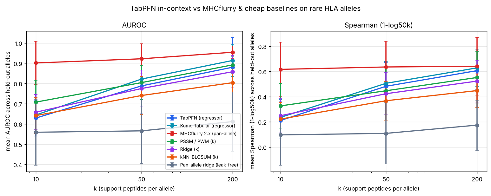

# TabPFN in-context learning vs pan-allele prediction for rare HLA class I alleles

_CPU-only feasibility check. No neural networks were trained; TabPFN v2 is used for in-context inference only._

## Verdict

**No. On held-out rare HLA class I alleles, TabPFN with a small support set does not beat MHCflurry 2.x, and only marginally beats a PSSM.** At k=200 support peptides (24 alleles with enough data), mean AUROC is TabPFN 0.880 vs MHCflurry 0.954 vs PSSM 0.892; TabPFN beats MHCflurry on only 0% of these alleles (mean AUROC delta -0.074), and beats the PSSM on 62% (delta -0.012). On Spearman of 1-log50k, TabPFN 0.606 vs MHCflurry 0.640.

At the smallest support (k=10, 44 alleles) TabPFN AUROC is 0.629 vs MHCflurry 0.902 vs PSSM 0.708.

**Kumo Tabular vs TabPFN (both in-context foundation models on the same k support peptides):** at k=200 Kumo AUROC 0.914 is slightly better than TabPFN 0.880 (Kumo beats TabPFN on 92% of alleles, mean AUROC delta +0.033; Spearman Kumo 0.628 vs TabPFN 0.606). Neither foundation model reaches MHCflurry's effectively-in-sample performance, and both sit in the same band as the cheap PSSM/ridge baselines.

**Crucial caveat (read this first):** MHCflurry 2.x was itself trained on the IEDB binding-affinity data this benchmark is drawn from, so for these "held-out" alleles it is effectively evaluated near-in-sample (63% of peptides occur in >1 allele; 92% of each held-out allele's peptides also appear in the high-data training pool). MHCflurry is therefore an *upper-bound* reference, not a fair out-of-distribution competitor. The honest leakage-free pan-allele reference is our own linear model trained only on disjoint high-data alleles, which is near chance (AUROC ~0.56). Against that bar, a handful of in-allele labels (TabPFN, PSSM, ridge) help enormously; against MHCflurry's effectively-seen labels, they do not catch up.

## Data provenance

- **Dataset:** `mhc1_iedb-imgt_nielsen` (NetMHCpan-style IEDB binding data, Nielsen/IEDB), obtained via PyTDC `tdc.multi_pred.PeptideMHC`.
- **PyTDC version:** 1.1.15. **Source:** Harvard Dataverse file id 4167073 (TDC `name2id`), downloaded 2026-11-21.
- **Rows:** 185,985 peptide-allele measurements; **alleles:** 153; unique peptides: 43,018 (full file).
- **Target Y:** 1-log50k affinity in [0,1]; binder threshold 500 nM (Y >= 0.4256).
- **First-pass scope:** HLA only, 9-mers only -> 121,720 rows, 103 alleles.
- **Models:** TabPFN v2 (tabpfn 10.2.0, checkpoints `tabpfn-v2-regressor` / `tabpfn-v2-classifier-finetuned-zk73skhh` from the public Prior-Labs HF repos; n_estimators=1, CPU). MHCflurry 2.3.30 `models_class1_presentation` affinity predictor (nM -> 1-log50k).
- **Kumo Tabular** (NVIDIA open tabular foundation model, `structured-data-models` 0.3.0, weights `nvidia/Kumo-Tabular` OpenMDW-1.1): size `small` (~28M params), num_estimators=1, CPU. Same BLOSUM features and same support/query splits as TabPFN (paired). Regression point estimate = mean of the 999 predictive quantiles.

## Split

- **Rare tail:** alleles with 50-1500 measurements (HLA 9-mers): 53 alleles.
- **Held out:** 44 rare alleles passing a pre-registered, result-independent data-quality filter (>=10 binders and >=10 non-binders so AUROC/AUPRC are defined). Range n=74-1428; loci A/B/C/E.
- **High-data pool (n>1500):** 30 alleles, 94,777 rows — used only for our own leakage-free pan-allele linear baseline. No held-out allele is ever in this pool.
- **Protocol:** per allele, k in {10,50,200,1000} capped at n//2, 5 seeds; support = k sampled peptides, query = the rest (capped at 500, identical query set scored by every method). Reported k-tiers use only alleles whose n//2>=k (uncapped); k=1000 is empty because the largest held-out allele has n=1428.

## Peptide overlap across alleles

- 12,650 of 20,171 unique HLA 9-mer peptides (62.7%) appear in more than one allele; the most-shared peptide appears in 46 alleles.
- On average 91.8% of a held-out allele's peptides also appear in the high-data pool. These are shared screening panels: the alleles are label-poor, not peptide-novel.

## Results: mean AUROC across held-out alleles, by k

| method | k=10 | k=50 | k=200 |
|---|---|---|---|
| TabPFN (regressor) | 0.629 | 0.788 | 0.880 |
| TabPFN (classifier) | 0.636 | 0.791 | 0.905 |
| Kumo Tabular (regressor) | 0.645 | 0.822 | 0.914 |
| Kumo Tabular (classifier) | 0.631 | 0.790 | 0.911 |
| MHCflurry 2.x (pan-allele) | 0.902 | 0.922 | 0.954 |
| MHCflurry + recal (k) | 0.863 | 0.909 | 0.943 |
| PSSM / PWM (k) | 0.708 | 0.804 | 0.892 |
| kNN-BLOSUM (k) | 0.641 | 0.741 | 0.804 |
| Ridge (k) | 0.658 | 0.775 | 0.858 |
| Logistic (k) | 0.648 | 0.784 | 0.887 |
| Pan-allele ridge (leak-free) | 0.559 | 0.566 | 0.612 |
| Pan-allele logistic (leak-free) | 0.553 | 0.560 | 0.600 |

## Results: mean Spearman (1-log50k) across held-out alleles, by k

| method | k=10 | k=50 | k=200 |
|---|---|---|---|
| TabPFN (regressor) | 0.211 | 0.482 | 0.606 |
| TabPFN (classifier) | 0.220 | 0.433 | 0.567 |
| Kumo Tabular (regressor) | 0.235 | 0.506 | 0.628 |
| Kumo Tabular (classifier) | 0.214 | 0.427 | 0.573 |
| MHCflurry 2.x (pan-allele) | 0.616 | 0.635 | 0.640 |
| MHCflurry + recal (k) | 0.637 | 0.666 | 0.679 |
| PSSM / PWM (k) | 0.327 | 0.447 | 0.552 |
| kNN-BLOSUM (k) | 0.222 | 0.367 | 0.448 |
| Ridge (k) | 0.249 | 0.423 | 0.523 |
| Logistic (k) | 0.238 | 0.416 | 0.535 |
| Pan-allele ridge (leak-free) | 0.097 | 0.109 | 0.174 |
| Pan-allele logistic (leak-free) | 0.085 | 0.098 | 0.160 |

## Results: mean AUPRC across held-out alleles, by k

| method | k=10 | k=50 | k=200 |
|---|---|---|---|
| TabPFN (regressor) | 0.442 | 0.625 | 0.704 |
| TabPFN (classifier) | 0.450 | 0.612 | 0.699 |
| Kumo Tabular (regressor) | 0.453 | 0.649 | 0.757 |
| Kumo Tabular (classifier) | 0.451 | 0.616 | 0.716 |
| MHCflurry 2.x (pan-allele) | 0.820 | 0.839 | 0.853 |
| MHCflurry + recal (k) | 0.727 | 0.794 | 0.814 |
| PSSM / PWM (k) | 0.545 | 0.606 | 0.671 |
| kNN-BLOSUM (k) | 0.450 | 0.535 | 0.541 |
| Ridge (k) | 0.465 | 0.574 | 0.625 |
| Logistic (k) | 0.452 | 0.591 | 0.664 |
| Pan-allele ridge (leak-free) | 0.381 | 0.373 | 0.312 |
| Pan-allele logistic (leak-free) | 0.376 | 0.368 | 0.303 |

## Best case: each allele at its largest support (~n/2)

Mean AUROC across all held-out alleles at their maximum support size:

| method | mean AUROC | std |
|---|---|---|
| TabPFN (regressor) | 0.856 | 0.150 |
| TabPFN (classifier) | 0.868 | 0.117 |
| Kumo Tabular (regressor) | 0.877 | 0.116 |
| Kumo Tabular (classifier) | 0.871 | 0.115 |
| MHCflurry 2.x (pan-allele) | 0.903 | 0.112 |
| MHCflurry + recal (k) | 0.894 | 0.117 |
| PSSM / PWM (k) | 0.845 | 0.126 |
| kNN-BLOSUM (k) | 0.791 | 0.105 |
| Ridge (k) | 0.839 | 0.120 |
| Logistic (k) | 0.843 | 0.123 |
| Pan-allele ridge (leak-free) | 0.561 | 0.160 |
| Pan-allele logistic (leak-free) | 0.553 | 0.170 |

## Results vs k

## Per-allele AUROC at largest support (key methods)

| allele | n | k | TabPFN | Kumo Tabular | MHCflurry 2.x | PSSM / PWM | Ridge | kNN-BLOSUM | Pan-allele ridge |
|---|---|---|---|---|---|---|---|---|---|
| HLA-A32:15 | 74 | 37 | 0.566 | 0.596 | 0.696 | 0.525 | 0.568 | 0.603 | 0.589 |
| HLA-C08:02 | 87 | 43 | 0.567 | 0.617 | 0.745 | 0.405 | 0.674 | 0.643 | 0.506 |
| HLA-E01:01 | 96 | 48 | 0.848 | 0.828 | 0.436 | 0.915 | 0.799 | 0.881 | 0.312 |
| HLA-B73:01 | 122 | 61 | 0.911 | 0.878 | 0.888 | 0.685 | 0.736 | 0.674 | 0.533 |
| HLA-B42:01 | 131 | 65 | 0.916 | 0.913 | 0.963 | 0.918 | 0.912 | 0.866 | 0.502 |
| HLA-A02:50 | 134 | 67 | 0.989 | 0.988 | 0.996 | 0.935 | 0.942 | 0.970 | 0.783 |
| HLA-C07:02 | 139 | 69 | 0.855 | 0.860 | 0.907 | 0.806 | 0.801 | 0.764 | 0.208 |
| HLA-B35:03 | 151 | 75 | 0.906 | 0.918 | 0.980 | 0.909 | 0.876 | 0.867 | 0.603 |
| HLA-C03:03 | 153 | 76 | 0.840 | 0.864 | 0.848 | 0.834 | 0.790 | 0.770 | 0.403 |
| HLA-B15:02 | 164 | 82 | 0.578 | 0.640 | 0.767 | 0.710 | 0.547 | 0.545 | 0.753 |
| HLA-A02:17 | 170 | 85 | 0.765 | 0.793 | 0.810 | 0.733 | 0.757 | 0.744 | 0.546 |
| HLA-C05:01 | 171 | 85 | 0.923 | 0.934 | 0.949 | 0.921 | 0.868 | 0.898 | 0.321 |
| HLA-C12:03 | 172 | 86 | 0.581 | 0.539 | 0.648 | 0.613 | 0.551 | 0.484 | 0.567 |
| HLA-A66:01 | 191 | 95 | 0.787 | 0.810 | 0.961 | 0.832 | 0.657 | 0.633 | 0.734 |
| HLA-C07:01 | 219 | 109 | 0.803 | 0.822 | 0.818 | 0.704 | 0.752 | 0.753 | 0.315 |
| HLA-C14:02 | 235 | 117 | 0.754 | 0.750 | 0.713 | 0.642 | 0.710 | 0.761 | 0.618 |
| HLA-C15:02 | 252 | 126 | 0.867 | 0.871 | 0.907 | 0.669 | 0.775 | 0.771 | 0.552 |
| HLA-B14:02 | 278 | 139 | 0.811 | 0.847 | 0.893 | 0.889 | 0.743 | 0.801 | 0.320 |
| HLA-C06:02 | 300 | 150 | 0.873 | 0.874 | 0.926 | 0.770 | 0.831 | 0.768 | 0.351 |
| HLA-B83:01 | 337 | 168 | 0.922 | 0.930 | 0.962 | 0.917 | 0.902 | 0.854 | 0.494 |
| HLA-B08:03 | 450 | 225 | 0.912 | 0.926 | 0.947 | 0.886 | 0.905 | 0.861 | 0.736 |
| HLA-B38:01 | 490 | 245 | 0.979 | 0.982 | 0.991 | 0.934 | 0.969 | 0.963 | 0.283 |
| HLA-A26:03 | 516 | 258 | 0.910 | 0.931 | 0.959 | 0.924 | 0.877 | 0.713 | 0.606 |
| HLA-C04:01 | 520 | 260 | 0.199 | 0.593 | 0.924 | 0.862 | 0.607 | 0.621 | 0.348 |
| HLA-B40:02 | 572 | 286 | 0.896 | 0.913 | 0.931 | 0.872 | 0.874 | 0.802 | 0.581 |
| HLA-B45:01 | 574 | 287 | 0.948 | 0.956 | 0.961 | 0.915 | 0.909 | 0.813 | 0.582 |
| HLA-B15:03 | 581 | 290 | 0.906 | 0.918 | 0.919 | 0.893 | 0.902 | 0.803 | 0.604 |
| HLA-A26:02 | 615 | 307 | 0.951 | 0.958 | 0.962 | 0.927 | 0.932 | 0.859 | 0.618 |
| HLA-B54:01 | 721 | 360 | 0.930 | 0.931 | 0.940 | 0.849 | 0.902 | 0.826 | 0.661 |
| HLA-B44:03 | 733 | 366 | 0.928 | 0.943 | 0.957 | 0.919 | 0.925 | 0.825 | 0.614 |
| HLA-B15:09 | 812 | 406 | 0.917 | 0.939 | 0.960 | 0.883 | 0.898 | 0.742 | 0.386 |
| HLA-A32:01 | 829 | 414 | 0.875 | 0.888 | 0.897 | 0.890 | 0.856 | 0.760 | 0.734 |
| HLA-B48:01 | 881 | 440 | 0.957 | 0.972 | 0.971 | 0.954 | 0.934 | 0.812 | 0.660 |
| HLA-A02:16 | 916 | 458 | 0.937 | 0.962 | 0.975 | 0.906 | 0.937 | 0.832 | 0.785 |
| HLA-A25:01 | 934 | 467 | 0.957 | 0.982 | 0.996 | 0.966 | 0.955 | 0.871 | 0.535 |
| HLA-B08:02 | 997 | 498 | 0.966 | 0.988 | 0.988 | 0.989 | 0.986 | 0.947 | 0.721 |
| HLA-B53:01 | 1051 | 525 | 0.908 | 0.923 | 0.946 | 0.904 | 0.885 | 0.807 | 0.592 |
| HLA-A02:11 | 1078 | 539 | 0.933 | 0.948 | 0.970 | 0.922 | 0.939 | 0.869 | 0.799 |
| HLA-A80:01 | 1164 | 582 | 0.967 | 0.970 | 0.968 | 0.948 | 0.959 | 0.848 | 0.567 |
| HLA-A02:12 | 1179 | 589 | 0.937 | 0.952 | 0.975 | 0.920 | 0.928 | 0.849 | 0.794 |
| HLA-A02:19 | 1240 | 620 | 0.952 | 0.974 | 0.986 | 0.940 | 0.946 | 0.887 | 0.854 |
| HLA-A30:02 | 1324 | 662 | 0.822 | 0.837 | 0.854 | 0.820 | 0.819 | 0.737 | 0.505 |
| HLA-A24:03 | 1370 | 685 | 0.955 | 0.959 | 0.967 | 0.945 | 0.954 | 0.891 | 0.475 |
| HLA-B15:17 | 1428 | 714 | 0.946 | 0.956 | 0.965 | 0.903 | 0.933 | 0.816 | 0.634 |

## Runtime per method (mean wall-seconds per fit+predict call, CPU, 4 cores)

| method | mean s/call |
|---|---|
| TabPFN (regressor) | 3.96 |
| TabPFN (classifier) | 3.80 |
| Kumo Tabular (regressor) | 2.83 |
| Kumo Tabular (classifier) | 2.73 |
| MHCflurry 2.x (pan-allele) | 0.00 |
| MHCflurry + recal (k) | 0.00 |
| PSSM / PWM (k) | 0.00 |
| kNN-BLOSUM (k) | 0.00 |
| Ridge (k) | 0.00 |
| Logistic (k) | 0.05 |
| Pan-allele ridge (leak-free) | 0.00 |
| Pan-allele logistic (leak-free) | 0.00 |

_MHCflurry and the pan-allele linear models are k/seed-independent (predicted once per peptide, zero target labels), shown at 0 s in-loop._

---
_Coverage at report time: 44/44 held-out alleles complete._
