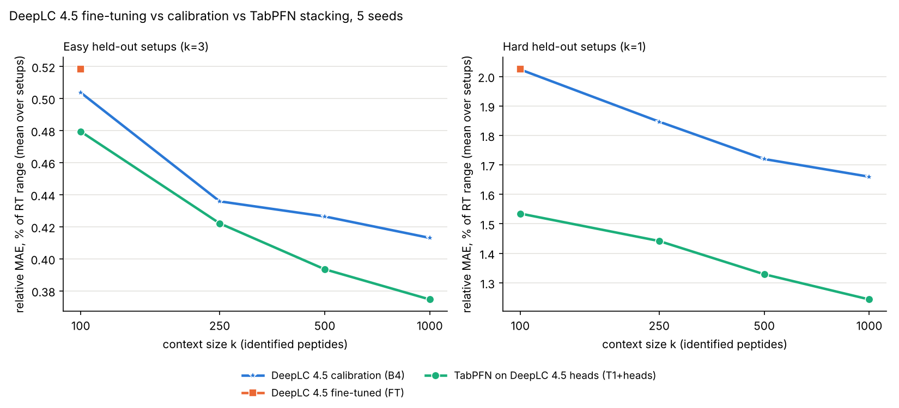

# DeepLC 4.5 fine-tuning vs TabPFN stacking on the 8 held-out setups

**Fine-tuning does not beat TabPFN stacking at any context size tested, so
there is no crossover in k = 100 to 1,000.** DeepLC 4.5 fine-tuned on the k
context peptides (FT) is worse than TabPFN on the DeepLC 4.5 heads (T1+heads,
the old winner) at every k in both groups. On the 5 hard setups FT is 21 to 27%
worse (geometric mean over setups), and the 95% CI over seeds lies above 1 on
19 of 20 (setup, k) cells. On the 3 easy setups the gap shrinks with k: 11.5%
at k = 100, 3.6% at 250, 4.8% at 500 and 1.4% at 1,000. At k = 1,000 FT is
significantly worse on 1 easy setup and indistinguishable on the other 2, so on
easy data the curves are converging and a crossover just above k = 1,000 is
plausible but not shown. Against DeepLC 4.5's default calibration (B4), FT
only pays off on easy setups from k = 500 (3% better at 500, 8% at 1,000); on
hard setups FT and B4 are tied on average at every k. The hybrid, TabPFN
stacked on the fine-tuned prediction (T1_d45_FT), is the best method overall:
5 to 7% better than T1+heads on easy setups at k >= 250 (CI below 1 on all 3
setups at k = 500 and 1,000), and identical to T1+heads on hard setups. Feeding
TabPFN the B4 calibrated prediction instead (T1_d45_B4, no fine-tuning) gives
nearly the same gain as the hybrid at a fraction of the cost.

## Main table: relative MAE, % of RT range

Mean over setups of the 5-seed mean. Lower is better. Per-setup mean and
standard deviation over the 5 seeds are in `tables.md` and `results.csv`.

| group | k | B4 calibration | FT fine-tuned | T1+heads | hybrid T1_d45_FT | T1_d45_B4 |
|---|---|---|---|---|---|---|
| easy | 100 | 0.504 | 0.534 | 0.479 | **0.468** | 0.472 |
| easy | 250 | 0.436 | 0.437 | 0.422 | 0.400 | **0.396** |
| easy | 500 | 0.426 | 0.412 | 0.393 | **0.372** | **0.372** |
| easy | 1000 | 0.413 | 0.379 | 0.375 | **0.351** | 0.356 |
| hard | 100 | 1.723 | 1.739 | **1.354** | 1.359 | 1.373 |
| hard | 250 | 1.498 | 1.491 | 1.219 | 1.211 | **1.207** |
| hard | 500 | 1.393 | 1.421 | 1.125 | 1.126 | **1.122** |
| hard | 1000 | 1.351 | 1.353 | 1.072 | 1.070 | **1.062** |

Geometric-mean ratio over setups (below 1 = the first method is better), and
the number of setups whose 95% CI over seeds (t-interval on the log ratio) lies
fully below / above 1:

| group | k | FT / B4 | FT / T1+heads | hybrid / FT | hybrid / T1+heads | T1_d45_B4 / T1+heads |
|---|---|---|---|---|---|---|
| easy (3) | 100 | 1.063 (0 / 0) | 1.115 (0 / 2) | 0.876 (3 / 0) | 0.977 (1 / 0) | 0.985 (0 / 0) |
| easy (3) | 250 | 1.004 (0 / 0) | 1.036 (0 / 0) | 0.915 (1 / 0) | 0.948 (1 / 0) | 0.936 (2 / 0) |
| easy (3) | 500 | 0.970 (0 / 0) | 1.048 (0 / 1) | 0.902 (3 / 0) | 0.945 (3 / 0) | 0.941 (3 / 0) |
| easy (3) | 1000 | 0.920 (2 / 0) | 1.014 (0 / 1) | 0.920 (3 / 0) | 0.933 (3 / 0) | 0.946 (2 / 0) |
| hard (5) | 100 | 1.007 (0 / 0) | 1.272 (0 / 4) | 0.788 (4 / 0) | 1.002 (0 / 0) | 1.012 (0 / 0) |
| hard (5) | 250 | 0.998 (1 / 0) | 1.210 (0 / 5) | 0.823 (5 / 0) | 0.996 (0 / 0) | 0.993 (0 / 0) |
| hard (5) | 500 | 1.007 (1 / 1) | 1.220 (0 / 5) | 0.818 (5 / 0) | 0.999 (0 / 0) | 0.997 (1 / 0) |
| hard (5) | 1000 | 0.987 (2 / 1) | 1.225 (0 / 5) | 0.814 (5 / 0) | 0.997 (0 / 0) | 0.992 (0 / 0) |

## Findings

1. **FT vs B4 (does fine-tuning beat DeepLC's own calibration?).** Only with
   enough data and only on easy setups. At k = 100 FT is 6% worse on easy
   setups and tied on hard ones; DeepLC itself warns below 500 reference
   peptides (`MIN_FINETUNE_REFERENCE = 500`; here the training part is 85% of
   k). At k = 1,000 FT is 8% better on easy setups (CI below 1 on PXD062983
   and PXD076643). On hard setups the picture is mixed: FT is better on
   PXD050641 (5 to 9% from k = 250) and PXD085246 at k = 1,000, but 13% worse
   on PXD084949 at k = 500 and 1,000 (CI above 1). On average over hard setups
   FT and B4 are within 1.3% at every k.
2. **FT vs T1+heads (the question asked).** T1+heads wins at every k in both
   groups. No setup has a CI for FT / T1+heads below 1 at any k. The hard-group
   gap does not close with k (1.27 at 100, 1.23 at 1,000). On easy setups it
   narrows to 1.4% at k = 1,000, where only PXD062983 is still significant.
3. **The hybrid (TabPFN on top of the fine-tuned model).** Since FT does not
   win, the hybrid is mainly a check of whether fine-tuning adds information
   that TabPFN cannot get from the frozen heads. On easy setups it does: the
   hybrid is 5 to 7% better than T1+heads at k >= 250 and the best method in
   the study. On hard setups it adds nothing (ratio 0.996 to 1.002, no CI away
   from 1). The hybrid is 8 to 21% better than FT itself everywhere, with the
   CI below 1 on 29 of 32 (setup, k) cells, so in-context calibration still
   adds a lot on top of a fine-tuned DeepLC.
4. **B4 prediction as an extra TabPFN feature (open item from the old
   study).** It helps on easy setups (6% at k = 250 to 1,000, CI below 1 on 2
   or 3 of 3 setups from k = 250) and does nothing on hard setups (within 1%,
   1 of 20 cells significant). It gets about the same gain as the hybrid on
   easy setups without any fine-tuning: T1_d45_B4 costs 34 to 94 s per run
   against 92 to 813 s for the hybrid. **Recommendation: make T1_d45_B4 the
   new default of `predict.py`** (not yet done here; the change is one extra
   column).
5. **Modified vs unmodified queries.** FT is relatively better on modified
   peptides on hard setups (1.88 vs 1.95 for B4 at k = 1,000), but still worse
   than T1+heads (1.75). On unmodified peptides on hard setups FT is worse than
   B4 at every k. See `tables.md`.
6. **Side observation, not part of the protocol.** The shipped
   `finetune_and_predict` path recalibrates the fine-tuned column on the
   context (`calibrate` with MultiHeadRidgeCalibration). Skipping that step
   (FT_raw, the fine-tuned head's raw output) is 2 to 5% better than FT in
   every cell (geometric mean). FT_raw still loses to T1+heads on hard setups
   by 17 to 21% at every k; on easy setups it is 2% better at k = 1,000
   (mostly PXD076643). This variant was not chosen beforehand, so treat it as
   a hint for DeepLC users, not as a headline number.
7. **Intervals.** Adding the FT or B4 column leaves TabPFN's 90% interval
   coverage (0.88 to 0.91) and width unchanged.

## Headroom: DeepLC 4.5 with no target labels vs fine-tuned on the largest context

HEADROOM_TABLE

## Timing

TIMING_TABLE

## Protocol

- **Data, splits, seeds, metric:** reused unchanged from the old study
  (`rtpoc/run.py` `split`, contexts are the first k of the pool, up to 2,000
  queries, relative MAE divided by the setup's full RT range). B4 and T1+heads
  numbers are the stored ones from `results/parts/H_<setup>.csv`. B4 was also
  recomputed here (B4_check) and matches the stored values to the 4th digit on
  every cell, which confirms the splits are identical.
- **Fine-tuning API:** DeepLC 4.5.0's shipped transfer-learning path.
  `deeplc.finetune_and_predict` is `deeplc.finetune` followed by
  `deeplc.calibrate` on the reference; it does not accept a validation set, so
  `rtpoc/ft_d45.py` calls the same two public functions in the same order and
  passes our own 15% validation split to `finetune(psm_list_validation=...)`.
  There is no training loop of our own. For the default model DeepLC adds a new
  low-rank setup head (66 trainable parameters) and keeps the encoder and the
  pretrained heads frozen; it anchors the head by least squares before
  training, early-stops on validation L1 and restores the best weights.
- **Validation split:** 15% of the context (at least 2 peptides), drawn with a
  seed-dependent permutation; fine-tuning sees the other 85%. The final
  calibration step uses the whole context. Query peptides are never touched.
- **Hyperparameters, fixed once on Part 1 datasets** (yeast_120min_psms_aligned
  and prosit_ptm_2020, which are not among the held-out setups), k = 100 and
  1,000, seeds 0 and 1, geometric-mean relative MAE:

  | config | lr | max epochs | patience | geo-mean rel. MAE |
  |---|---|---|---|---|
  | A (DeepLC defaults) | 0.05 | 50 | 10 | 0.02045 |
  | B | 0.05 | 150 | 20 | 0.02009 |
  | C | 0.2 | 100 | 15 | 0.02188 |
  | **D (chosen)** | **0.01** | **150** | **20** | **0.01988** |

  Batch size and everything else are DeepLC defaults. The same config is used
  for every held-out setup and k.
- **Stacking without leakage:** TabPFN never sees an in-sample prediction. For
  the hybrid, the context column is 3-fold cross-fitted (each fold fine-tuned
  on the other 2/3 of the context, with its own 15% validation split) and the
  query column comes from the full-context fine-tune. For T1_d45_B4 the context
  column is 5-fold cross-fitted B4. 3 folds rather than 5 for the hybrid was a
  compute choice.
- **5 seeds** per (setup, k); `torch.manual_seed(seed)` is set before each
  fine-tune.
- **Grid runs** used 1 torch thread per job and 4 jobs on the 4 cores; the
  separate timing pass used 4 threads on an otherwise idle machine.

## Caveats and negative results

- The hybrid's gain on easy setups is real but small in absolute terms
  (0.024 percentage points of the RT range at k = 1,000, about 2 s on a
  127-min gradient).
- Only 3 easy and 5 hard setups; the per-setup CIs are over 5 seeds of the
  same setup, not over setups.
- Config D hit the 150-epoch cap in some runs (max 150 epochs run), so a
  longer schedule might help FT a little. It was not tuned further to keep the
  protocol fixed.
- The default model's fine-tuning only trains a new 66-parameter head. A
  deeper fine-tune (unfreezing the encoder) is not what DeepLC ships for this
  model and was not tried.
- The epoch counter in `rtpoc/ft_d45.py` counts one extra validation pass
  (DeepLC runs a post-training sanity check); the aggregate script subtracts
  it, so the epoch numbers in the tables are correct.

## Files

- `results.csv`: one row per (setup, k, seed, method, query subset), with
  `rel_mae_pct` = relative MAE in % of RT range.
- `tables.md`: all tables, including per-setup mean ± SD and CIs.
- `curves_finetune.png`: the plot above.
- `timing_4threads.csv`, `parts/HR_*.csv`: timing pass and headroom runs.
- `tune_*.csv`: hyperparameter selection on Part 1.
- Code: `rtpoc/ft_d45.py`, `rtpoc/ft_tune.py`, `rtpoc/run_ft.py`,
  `rtpoc/ft_timing.py`, `rtpoc/ft_headroom.py`, `rtpoc/ft_aggregate.py`,
  `rtpoc/run_ft_all.sh`, `rtpoc/run_ft_after.sh`.
