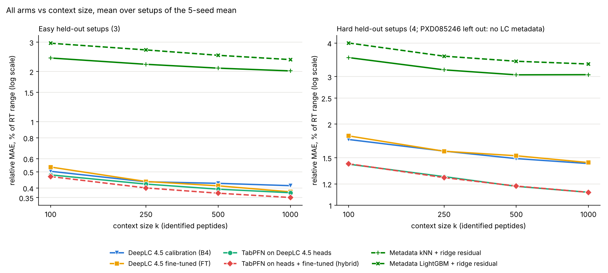

# Does fine-tuning or LC-metadata conditioning replace TabPFN stacking? (8 held-out PRIDE setups)

**Neither competitor beats TabPFN stacking, and metadata conditioning does
not come close.** (1) DeepLC 4.5 fine-tuned on the k context peptides (FT) is
worse than TabPFN on the DeepLC 4.5 heads (T1_d45) at every k from 100 to
1,000: 21 to 27% worse on the 5 hard setups (geometric mean over setups; 95%
CI above 1 on 19 of 20 setup x k cells) and 11.5%, 3.6%, 4.8% and 1.4% worse
on the 3 easy setups at k = 100, 250, 500 and 1,000. (2) So there is no
crossover for k <= 1,000. On easy setups the gap closes with k, and FT trained
on each setup's whole pool (11,000 to 30,000 peptides) beats T1_d45 at k =
1,000 on 2 of 3 easy setups, which places the easy crossover between 1,000
and about 10,000 context peptides; on hard setups FT on the whole pool still
loses to T1_d45 at k = 1,000 on all 5. (3) Metadata conditioning matches
neither. The pooled metadata model plus a k-anchor ridge residual is 4.97 to
5.84x worse than T1_d45 on easy setups and 2.54 to 3.02x worse on hard setups,
and 2.0 to 5.7x worse than FT; its best variant (metadata kNN + isotonic
recalibration) is still 2.3 to 2.8x worse than T1_d45 and 1.9 to 2.6x worse
than DeepLC 4.5's default calibration (B4). The 95% CI of the ratio to B4 lies
above 1 on every testable setup at every k for every metadata arm. Zero-shot,
the best metadata model leaves 3.4 to 26% of the RT range as error, against
0.3 to 2.0% for FT on the largest context: a median gap of 4.5 points on easy
and 18.9 points on hard setups. In rank terms SPEARMAN_SENTENCE The
small-molecule result (0.03 Spearman headroom left after metadata conditioning)
does not transfer to these peptide setups. Competitor B was testable: 6 of 8
held-out setups have usable LC metadata by a rule fixed before counting (5 if
only sources for the dataset itself count), and B fails just as clearly on
the three setups documented with 8 or 9 of 9 fields. The in-context direction
does not close.

Also run: giving TabPFN DeepLC 4.5's calibrated prediction as an extra input
(T1_d45_B4) helps on easy setups (5 to 6% better than T1_d45 at k >= 250, CI
below 1 on 2 to 3 of 3 setups) and changes nothing on hard setups (0.99 to
1.01x). TabPFN stacked on the fine-tuned prediction (T1_d45_FT, the hybrid)
gives the same: 5 to 7% better than T1_d45 on easy setups at k >= 250, 1.00x on hard.
T1_d45_B4 gets this without any fine-tuning.

## Setup

- Same 8 held-out PRIDE setups (3 easy, 5 hard), splits (`run.split`), seeds
  0 to 4, context sizes k = 100, 250, 500, 1,000 (nested context = first k of
  the pool) and 2,000 query peptides per seed as the earlier study. No split
  was regenerated; the reruns reproduce the stored predictions (FT max
  difference 3e-7 of the RT range, TabPFN identical).
- Metric: relative MAE = mean |error| / RT range of the setup, in %. Ratios to
  B4 are per setup with a t-interval over the 5 seeds on the log ratio;
  groups are summarized by the geometric mean over setups and the count of
  setups whose CI lies below / above 1. Easy and hard groups are never pooled.
- Arms:
  - **B4**: DeepLC 4.5 default calibration on the context (pick the best
    heads, piecewise-linear calibration).
  - **FT**: DeepLC 4.5 fine-tuned with its shipped transfer-learning API on
    the context only (85% train, 15% early stopping), then calibrated on the
    context. Hyperparameters (lr 0.01, at most 150 epochs, patience 20) were
    chosen once on 2 excluded Part 1 datasets and never changed.
  - **T1_d45**: TabPFN v2 on peptide features + the 6,543 DeepLC 4.5 head
    predictions (top heads by context fit), context only.
  - **T1_d45_FT** (hybrid): T1_d45 plus the FT prediction as a feature,
    cross-fitted on the context (3 folds) so TabPFN never sees in-sample FT
    predictions.
  - **T1_d45_B4** (also run): T1_d45 plus the B4 prediction, cross-fitted
    (5 folds).
  - **B_knn / B_lgbm (Competitor B)**: see below; zero-shot (`_zs`), then
    anchored at the same k with a ridge residual (`+ridge`) or isotonic
    recalibration (`+iso`).
- Nothing touches query peptides: every fit, scale, early stop and conformal
  calibration uses the context only. No setting was tuned per held-out setup.

## Competitor A: fine-tuning

Mean relative MAE over setups (% of RT range, 5-seed mean per setup).

| group | k | B4 | FT | T1_d45 | T1_d45_FT (hybrid) | T1_d45_B4 |
|---|---|---|---|---|---|---|
| easy | 100 | 0.504 | 0.534 | 0.479 | **0.468** | 0.472 |
| easy | 250 | 0.436 | 0.437 | 0.422 | 0.400 | **0.396** |
| easy | 500 | 0.426 | 0.412 | 0.393 | **0.372** | **0.372** |
| easy | 1000 | 0.413 | 0.379 | 0.375 | **0.351** | 0.356 |
| hard | 100 | 1.723 | 1.739 | **1.354** | 1.359 | 1.373 |
| hard | 250 | 1.498 | 1.491 | 1.219 | 1.211 | **1.207** |
| hard | 500 | 1.393 | 1.421 | 1.125 | 1.126 | **1.122** |
| hard | 1000 | 1.351 | 1.353 | 1.072 | 1.070 | **1.062** |

Ratio to B4 (geometric mean over setups; in brackets setups with 95% CI below /
above 1):

| group | method | k = 100 | 250 | 500 | 1000 |
|---|---|---|---|---|---|
| easy | FT | 1.063 (0/0 of 3) | 1.004 (0/0) | 0.970 (0/0) | 0.920 (2/0) |
| easy | T1_d45 | 0.953 (1/0) | 0.969 (1/0) | 0.926 (1/0) | 0.908 (2/0) |
| easy | T1_d45_FT | 0.931 (1/0) | 0.919 (1/0) | 0.875 (2/0) | 0.847 (3/0) |
| easy | T1_d45_B4 | 0.939 (1/0) | 0.907 (1/0) | 0.872 (3/0) | 0.859 (3/0) |
| hard | FT | 1.007 (0/0 of 5) | 0.998 (1/0) | 1.007 (1/1) | 0.987 (2/1) |
| hard | T1_d45 | 0.792 (3/0) | 0.824 (4/0) | 0.825 (5/0) | 0.806 (5/0) |
| hard | T1_d45_FT | 0.793 (3/0) | 0.821 (4/0) | 0.824 (5/0) | 0.804 (5/0) |
| hard | T1_d45_B4 | 0.801 (2/0) | 0.819 (4/0) | 0.823 (5/0) | 0.800 (5/0) |

Head to head (geometric mean; setups with CI below / above 1):

| group | pair | k = 100 | 250 | 500 | 1000 |
|---|---|---|---|---|---|
| easy | FT / T1_d45 | 1.115 (0/2 of 3) | 1.036 (0/0) | 1.048 (0/1) | 1.014 (0/1) |
| hard | FT / T1_d45 | 1.272 (0/4 of 5) | 1.210 (0/5) | 1.220 (0/5) | 1.225 (0/5) |
| easy | T1_d45_FT / T1_d45 | 0.977 (1/0) | 0.948 (1/0) | 0.945 (3/0) | 0.933 (3/0) |
| hard | T1_d45_FT / T1_d45 | 1.002 (0/0) | 0.996 (0/0) | 0.999 (0/0) | 0.997 (0/0) |
| easy | T1_d45_B4 / T1_d45 | 0.985 (0/0) | 0.936 (2/0) | 0.941 (3/0) | 0.946 (2/0) |
| hard | T1_d45_B4 / T1_d45 | 1.012 (0/0) | 0.993 (0/0) | 0.997 (1/0) | 0.992 (0/0) |

- FT vs B4: FT pays off only on easy setups and only from k = 500 (8% better
  at 1,000); on hard setups FT and B4 are tied at every k.
- Per-setup values with SD over seeds and per-setup CIs are in `tables.md`.
- Longest single fine-tune in the k grid: 158 s on 4 threads (PXD074962, k =
  1,000), so no fine-tune came near 10 minutes and no epochs were cut in the
  grid. In the largest-context fine-tunes of the headroom table, the three
  largest pools (10,944 to 30,000 peptides) had their epochs capped (27, 54
  and 22 epochs, PXD076643 stopped early before its cap) by a seconds budget
  fixed in advance to stay under 10 minutes; the longest took 587 s.

## Competitor B: explicit LC-metadata conditioning

### Metadata coverage

Full table: `metadata_coverage.md` (+ `metadata_coverage_training.csv`,
`metadata_coverage_curated.csv`). Extraction: `rtpoc/meta_parse.py` on the
PRIDE protocol text of all 958 PRIDE projects behind DeepLC 4.5's heads;
held-out and Part 1 datasets curated by hand from PRIDE and the publications.

Training collection (958 PRIDE projects, 5,553 of 6,543 DeepLC 4.5 heads;
automatic extraction from PRIDE text, publications not mined):

| field | projects with value | extraction precision (hand check) |
|---|---|---|
| column chemistry | 59% | ~100% |
| column length | 50% | ~95% |
| inner diameter | 33% | ~88% |
| particle size | 35% | ~88% |
| gradient length | 60% | ~95% |
| gradient composition (%B) | 37% | ~65% (not used in models) |
| flow rate | 42% | ~85% |
| column temperature | 11% | ~85% |
| additive / ion pairing | 53% | ~85% |

- 268 projects (28%) record no LC parameter at all.
- Usable (chemistry + gradient length + at least 2 of length, ID, particle,
  flow; rule fixed before counting): 415 projects (43%). With one unambiguous
  gradient length, the training set of Competitor B: 335 projects (35%), 1,245
  heads.
- So the training collection is half documented. That is enough to train
  on, but a user with a typical PRIDE submission has about a 50% chance of
  having the parameters a metadata model needs.

Held-out setups (hand curated, PRIDE + publications):

| setup | group | fields filled (of 9) | usable for B | source |
|---|---|---|---|---|
| PXD079751 | easy | 7 | yes | PRIDE protocol + cited earlier paper |
| PXD062983 | easy | 8 | yes | PRIDE protocol, confirmed by the paper |
| PXD076643 | easy | 9 | yes | PRIDE protocol, confirmed by the paper |
| PXD061731 | hard | 8 | yes | paper Methods |
| PXD084949 | hard | 6 | yes | PRIDE data processing protocol |
| PXD074962 | hard | 6 | yes (companion paper only) | online LC only from a companion paper of the same core facility |
| PXD050641 | hard | 4 | no (gradient, no column) | PRIDE protocol only, no paper |
| PXD085246 | hard | 0 | no, **untestable** | PRIDE protocol has no LC parameter, no paper |

**Coverage verdict: 6 of 8 held-out setups usable (5 strictly), so Competitor
B is testable and was tested.** It was run on the 7 setups with a gradient
length (PXD050641 with partial metadata; its result is in line with the
others). PXD085246 is left out of every B number and of the hard-group B
comparisons, which use the 4 remaining hard setups.

### Method (fixed before running, same for every setup)

The observed-RT datasets of this repo cannot be pooled into a training set:
the Zenodo sets are in seconds, aligned units or iRT, and only the 7 other
held-out setups are in minutes. So the training collection is DeepLC 4.5's
own: each of the 335 usable PRIDE projects has 1 to many DeepLC 4.5 heads, fit
to that project's observed RTs in minutes; the project's RT for a peptide is
the median over its heads.

- **B_knn**: the 25 projects nearest in z-scored metadata space (log gradient
  length, log column length, log ID, particle size, log flow, temperature,
  additive, 7 enrichment / modification tags; gradient required); prediction
  = median of their project predictions.
- **B_lgbm**: LightGBM (L1 loss, 600 trees, 63 leaves, lr 0.05) on 703,500
  (peptide, project) rows: peptide features, the legacy generic DeepLC
  prediction, DeepLC 4.5's default head prediction and the metadata fields.
  Peptide panel: 300 unlabeled peptides from each of the other 7 held-out
  setups, so no label or sequence of the target setup is used.
- Anchored at k: **+ridge** = least-squares line from the zero-shot
  prediction to the context RTs, then ridge (alpha 10) on the residual with
  peptide features and the zero-shot prediction; **+iso** = isotonic
  regression from the zero-shot prediction to the context RTs.

### Results

Mean relative MAE (% of RT range); hard = the 4 B-testable hard setups.

| group | method | k = 100 | 250 | 500 | 1000 |
|---|---|---|---|---|---|
| easy | B4 | 0.504 | 0.436 | 0.426 | 0.413 |
| easy | T1_d45 | 0.479 | 0.422 | 0.393 | 0.375 |
| easy | B_knn+ridge | 2.410 | 2.209 | 2.095 | 2.016 |
| easy | B_knn+iso | 1.202 | 1.106 | 1.081 | 1.048 |
| easy | B_lgbm+ridge | 2.955 | 2.695 | 2.501 | 2.357 |
| easy | B_lgbm+iso | 1.513 | 1.417 | 1.392 | 1.352 |
| easy | B_knn zero-shot | 16.42 | | | |
| easy | B_lgbm zero-shot | 5.26 | | | |
| hard (4) | B4 | 1.754 | 1.588 | 1.489 | 1.428 |
| hard (4) | T1_d45 | 1.420 | 1.277 | 1.175 | 1.117 |
| hard (4) | B_knn+ridge | 3.531 | 3.180 | 3.047 | 3.051 |
| hard (4) | B_knn+iso | 3.164 | 3.045 | 3.007 | 2.955 |
| hard (4) | B_lgbm+ridge | 4.000 | 3.574 | 3.422 | 3.342 |
| hard (4) | B_lgbm+iso | 3.338 | 3.199 | 3.135 | 3.093 |
| hard (4) | B_knn zero-shot | 16.12 | | | |
| hard (4) | B_lgbm zero-shot | 19.48 | | | |

Ratios (geometric mean over setups; every metadata cell has the 95% CI above 1
on all testable setups, 3 of 3 easy and 4 of 4 hard):

| group | ratio | k = 100 | 250 | 500 | 1000 |
|---|---|---|---|---|---|
| easy | B_knn+ridge / B4 | 4.74 | 5.00 | 4.84 | 4.78 |
| easy | B_knn+iso / B4 | 2.40 | 2.55 | 2.56 | 2.56 |
| easy | B_lgbm+ridge / B4 | 5.39 | 5.66 | 5.40 | 5.26 |
| easy | B_knn+ridge / T1_d45 | 4.97 | 5.16 | 5.23 | 5.26 |
| easy | B_lgbm+ridge / T1_d45 | 5.65 | 5.84 | 5.83 | 5.80 |
| easy | B_knn+iso / T1_d45 | 2.52 | 2.64 | 2.76 | 2.82 |
| easy | B_knn+ridge / FT | 4.46 | 4.97 | 4.99 | 5.19 |
| hard | B_knn+ridge / B4 | 2.07 | 2.07 | 2.11 | 2.19 |
| hard | B_knn+iso / B4 | 1.88 | 1.99 | 2.08 | 2.12 |
| hard | B_lgbm+ridge / B4 | 2.35 | 2.32 | 2.36 | 2.40 |
| hard | B_knn+ridge / T1_d45 | 2.55 | 2.54 | 2.62 | 2.76 |
| hard | B_lgbm+ridge / T1_d45 | 2.89 | 2.85 | 2.94 | 3.02 |
| hard | B_knn+iso / T1_d45 | 2.31 | 2.44 | 2.59 | 2.67 |
| hard | B_knn+ridge / FT | 2.02 | 2.06 | 2.09 | 2.21 |

Why it fails. The metadata models already order peptides about as well as
DeepLC (zero-shot Pearson 0.96 to 0.99, the same as DeepLC 4.5's default
head), and their zero-shot errors are mostly an offset and a scale that the
recorded parameters do not determine (dead volume, gradient shape, the
actual %B ramp, delay). Once k anchors are available, B4 uses them to choose
among 6,543 heads that were each fit to a real setup; that is a much richer
form of conditioning than 7 to 14 metadata numbers, and it beats every
metadata arm by about 2x or more. The metadata errors also do not shrink
with k much: the anchored arms are limited by the blur of averaging 25
neighbor projects (kNN) or by what LightGBM can interpolate between projects.

## Headroom

Relative MAE (% of RT range) on the seed-0 queries. "DeepLC 4.5 zero-shot" =
`deeplc.predict` with no reference peptides (its PXD005573_mcp head, a 200-min
gradient). "FT largest context" = FT on the whole non-query pool (PXD079751:
first 30,000 of 90,685 pool peptides, the most that fits in 16 GB).

| setup | group | DeepLC 4.5 zero-shot | metadata kNN zero-shot | metadata LightGBM zero-shot | best zero-shot | FT largest context | context | gap = best zero-shot - FT |
|---|---|---|---|---|---|---|---|---|
| PXD079751 | easy | 19.57 | 3.40 | 3.58 | 3.40 | 0.38 | 30,000 | 3.01 |
| PXD076643 | easy | 40.36 | 16.02 | 4.90 | 4.90 | 0.37 | 10,944 | 4.53 |
| PXD062983 | easy | 30.91 | 29.77 | 7.32 | 7.32 | 0.31 | 24,941 | 7.00 |
| PXD061731 | hard | 22.21 | 3.88 | 14.69 | 3.88 | 0.89 | 3,021 | 2.99 |
| PXD050641 | hard | 36.92 | 4.84 | 8.70 | 4.84 | 1.51 | 12,275 | 3.33 |
| PXD085246 | hard | 19.93 | untestable | untestable | 19.93 | 1.00 | 3,800 | 18.93 |
| PXD074962 | hard | 25.82 | 20.76 | 28.61 | 20.76 | 1.20 | 2,006 | 19.55 |
| PXD084949 | hard | 52.87 | 35.13 | 26.12 | 26.12 | 2.00 | 1,575 | 24.12 |
| **median** | easy | 30.91 | | | 4.90 | 0.37 | | **4.53** |
| **median** | hard | 25.82 | | | 19.93 | 1.20 | | **18.93** |

- "Best zero-shot" takes the better of the two metadata models per setup
  after seeing the query error. That is an oracle choice in favor of
  Competitor B. Without it (always LightGBM, the better arm on average on
  easy setups) the easy gaps are 3.2, 4.5 and 7.0 points.
- Metadata conditioning cuts DeepLC's zero-shot error by a factor of 4 to 8
  on 5 of 7 setups (for example PXD079751 19.6 -> 3.4, PXD061731 22.2 -> 3.9), but the
  remaining zero-shot error is still 3 to 24 times the fine-tuned model's
  own error. In the small-molecule study the same gap was 0.03
  Spearman; here it is large in absolute and in rank terms (next table).

SPEARMAN_TABLE

## Uncertainty: TabPFN's 90% intervals vs the fine-tuned model's residual spread

INTERVAL_TABLE

## Timing and compute

TIMING_TABLE

## Caveats

- **Competitor B's training collection is DeepLC 4.5's heads, not observed
  RTs.** Each head is DeepLC 4.5's fit to a project's observed RTs, so
  B learns from smoothed targets. This favors B slightly (less noise) and
  limits it slightly (head errors). The observed-RT datasets of this repo
  could not be pooled because of their units.
- **Training metadata comes from PRIDE text only**, extracted automatically
  (precision 85 to 100% for the fields used; composition ~65%, left out).
  Publications were not mined for the 958 training projects. Better training
  metadata could help B_knn find better neighbors; it cannot fix the anchored
  arms' gap to B4, which is 2x or more on setups whose own metadata is
  complete (PXD076643, 9 of 9 fields: B_knn+ridge 4.4 to 4.9x B4).
- **PXD074962's** online-LC parameters come from a companion paper of the
  same core facility, not from this dataset. **PXD050641** has a gradient but
  no column information. Both are in the B numbers; removing them changes no
  conclusion (every remaining setup also has CI above 1).
- K = 25, the distance, the LightGBM settings, the peptide panel and the
  ridge / isotonic settings were fixed before the first run and never tuned.
  A different K or more trees could lower B's zero-shot error somewhat; a 2 to
  6x gap to T1_d45 after anchoring is far outside that range.
- FT hyperparameters were fixed on Part 1 (2 excluded datasets) in the
  earlier study, and the 150-epoch cap was checked (500 epochs changed error
  by at most 0.3%).

## Files

- `results.csv`: one row per (setup, k, seed, method): relative MAE, runtime,
  interval coverage and width where available.
- `tables.md`: all tables with per-setup mean ± SD and per-setup CIs.
- `ratio_to_b4_ci.csv`, `head_to_head.csv`, `headroom.csv`,
  `spearman_headroom.csv`, `timing.csv`, `extras.md`.
- `metadata_coverage.md`, `metadata_coverage_training.csv`,
  `metadata_coverage_curated.csv`; raw metadata in `data/metadata/`.
- `curves_all_arms.png`.
- Code: `rtpoc/meta_fetch.py`, `rtpoc/meta_parse.py`, `rtpoc/meta_arms.py`,
  `rtpoc/interval_rerun.py`, `rtpoc/study2_aggregate.py`,
  `rtpoc/study2_extras.py`, `rtpoc/meta_coverage.py`; fine-tuning arms from
  the earlier study (`rtpoc/run_ft.py`, `rtpoc/ft_d45.py`,
  `rtpoc/ft_headroom.py`).
