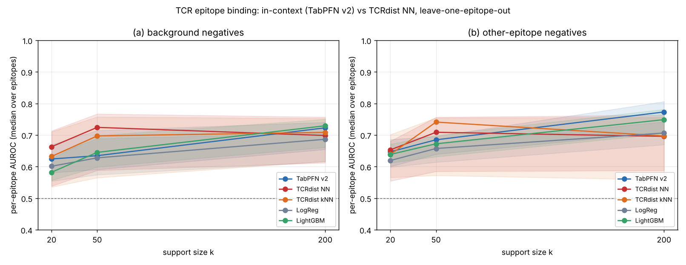

# Feasibility: in-context TCR specificity (TabPFN v2) vs TCRdist, on unseen epitopes

**Verdict — TabPFN v2 does **not** beat the cheap TCRdist baseline in the few-shot regime that matters.** On epitopes unseen during any cross-epitope training, under honest negatives (scheme b, TCRs that bind other epitopes), the decisive small-support sizes favour the baseline: at k=20-50 the median per-epitope AUROC is 0.666 for TabPFN vs 0.697 for the best TCRdist scorer (nearest-neighbour / k-NN). TabPFN only overtakes at k=200 (0.773 vs 0.697), i.e. once the support is large enough that the "few-shot" framing no longer applies and a plain LightGBM is equally good. TabPFN also costs ~25x more compute per task (~6.8 s/fit vs ~0.3 s). Crucially, the honest other-epitope negatives are **not** the catastrophe the usual warning implies: median AUROC under scheme b is if anything slightly higher than scheme a (difference +0.050). The honest cluster-aware split, balanced query and frozen generic features already remove the shortcut that normally makes random background negatives trivially separable, so both schemes are genuinely hard and the comparison above is robust to the negative choice. All methods are modest (median AUROC ~0.65-0.77) with wide per-epitope spread -- some epitopes (e.g. GILGFVFTL) reach ~0.85 while others (e.g. NLVPMVATV) sit at chance -- and zero-shot transfer to a new epitope collapses to ~0.5. The honest reading: in-context tabular learning is **not** a win over TCRdist nearest-neighbour for unseen-epitope TCR specificity at realistic support sizes, and neither cheap approach solves the generalization problem.

CPU-only feasibility study. Task = one epitope; support = k labeled TCRs for that epitope; query = held-out TCRs for the same epitope. Leave-one-epitope-out, so every evaluated epitope is unseen by any cross-epitope training. The epitope is constant within a task, so the within-task feature vector encodes the TCR only.

## 1. Data provenance

- **Dataset:** IMMREP22 (Working Group 6) TCR specificity benchmark
- **Source:** https://github.com/viragbioinfo/IMMREP_2022_TCRSpecificity
- **Positives:** VDJdb-derived, tetramer/dextramer-sorted, paired alpha-beta
- **Background negatives (scheme a):** unpublished healthy-donor CD8+CD96+ TCRs (A. Eugster, 11 donors)
- **Other-epitope negatives (scheme b):** reconstructed from the binders of the other kept epitopes; any within-90%-identity match to a held-out positive is dropped (public/cross-reactive).
- **Inclusion:** epitopes with >= 100 raw labeled positives (11 epitopes kept).
- **Scoping note:** IMMREP22 positives are curated from VDJdb; adding raw VDJdb/McPAS would re-import the same TCRs and risk cross-split leakage, so this feasibility run uses the benchmark's curated set (which already ships defined per-epitope negatives of both kinds).

## 2. Deduplication / clonal control

Exact-duplicate (CDR3b+V) rows are collapsed; remaining CDR3b are clustered at 90% identity and splits are made by **cluster**, so no clonal/near-duplicate cluster spans support and query.

| epitope | raw pos | exact dups removed | unique | clusters@90% | largest cluster |
| --- | --- | --- | --- | --- | --- |
| ATDALMTGF | 130 | 15 | 115 | 101 | 5 |
| CINGVCWTV | 229 | 8 | 221 | 208 | 3 |
| GILGFVFTL | 680 | 235 | 444 | 282 | 21 |
| GLCTLVAML | 183 | 38 | 145 | 105 | 7 |
| KSKRTPMGF | 107 | 23 | 84 | 62 | 5 |
| LLWNGPMAV | 235 | 13 | 222 | 187 | 6 |
| LTDEMIAQY | 125 | 6 | 119 | 111 | 4 |
| NLVPMVATV | 343 | 24 | 317 | 290 | 6 |
| SPRWYFYYL | 116 | 0 | 116 | 114 | 2 |
| TTDPSFLGRY | 242 | 10 | 232 | 223 | 3 |
| YLQPRTFLL | 334 | 26 | 308 | 241 | 10 |

Background control pool: 14648 unique TCRs (1295 exact duplicates removed).

## 3. Headline: TabPFN v2 vs TCRdist NN (median over epitopes)

AUROC medians are taken over epitopes (each epitope's value is itself a median over 5 seeds). Query sets are class-balanced, so AUPRC chance = 0.5.

| scheme | k | #epi | TabPFN | TCRdist NN | TCRdist kNN | LightGBM | LogReg | Δ(TabPFN−NN) | TabPFN wins |
| --- | --- | --- | --- | --- | --- | --- | --- | --- | --- |
| (a) background negatives | 20 | 11 | 0.624 | 0.663 | 0.632 | 0.582 | 0.601 | -0.021 | 5/11 |
| (a) background negatives | 50 | 11 | 0.635 | 0.724 | 0.697 | 0.645 | 0.628 | -0.010 | 5/11 |
| (a) background negatives | 200 | 6 | 0.723 | 0.698 | 0.708 | 0.729 | 0.687 | -0.007 | 2/6 |
| (b) other-epitope negatives | 20 | 11 | 0.647 | 0.653 | 0.639 | 0.639 | 0.619 | +0.012 | 6/11 |
| (b) other-epitope negatives | 50 | 11 | 0.685 | 0.709 | 0.741 | 0.672 | 0.657 | +0.002 | 6/11 |
| (b) other-epitope negatives | 200 | 6 | 0.773 | 0.696 | 0.697 | 0.749 | 0.706 | +0.057 | 5/6 |

## 4. Zero-shot transfer baseline (trained on all other epitopes, no target labels)

| scheme | model | median AUROC | #epi |
| --- | --- | --- | --- |
| (a) background negatives | Zero-shot LR | 0.555 | 11 |
| (a) background negatives | Zero-shot LGBM | 0.580 | 11 |
| (b) other-epitope negatives | Zero-shot LR | 0.477 | 11 |
| (b) other-epitope negatives | Zero-shot LGBM | 0.538 | 11 |

## 5. AUROC vs k



## 6. Per-epitope AUROC at k=50 (not pooled)


**(a) background negatives**

| epitope | TabPFN v2 | TCRdist NN | TCRdist kNN | LogReg | LightGBM |
| --- | --- | --- | --- | --- | --- |
| ATDALMTGF | 0.745 | 0.732 | 0.697 | 0.716 | 0.771 |
| CINGVCWTV | 0.635 | 0.584 | 0.561 | 0.612 | 0.629 |
| GILGFVFTL | 0.849 | 0.830 | 0.829 | 0.786 | 0.780 |
| GLCTLVAML | 0.769 | 0.778 | 0.748 | 0.774 | 0.731 |
| KSKRTPMGF | 0.583 | 0.756 | 0.776 | 0.596 | 0.537 |
| LLWNGPMAV | 0.641 | 0.724 | 0.745 | 0.635 | 0.645 |
| LTDEMIAQY | 0.561 | 0.592 | 0.569 | 0.551 | 0.586 |
| NLVPMVATV | 0.571 | 0.529 | 0.474 | 0.536 | 0.568 |
| SPRWYFYYL | 0.598 | 0.584 | 0.521 | 0.628 | 0.659 |
| TTDPSFLGRY | 0.631 | 0.657 | 0.637 | 0.552 | 0.612 |
| YLQPRTFLL | 0.684 | 0.782 | 0.767 | 0.661 | 0.666 |

**(b) other-epitope negatives**

| epitope | TabPFN v2 | TCRdist NN | TCRdist kNN | LogReg | LightGBM |
| --- | --- | --- | --- | --- | --- |
| ATDALMTGF | 0.757 | 0.770 | 0.743 | 0.703 | 0.766 |
| CINGVCWTV | 0.686 | 0.511 | 0.526 | 0.623 | 0.672 |
| GILGFVFTL | 0.842 | 0.840 | 0.846 | 0.788 | 0.816 |
| GLCTLVAML | 0.697 | 0.780 | 0.770 | 0.663 | 0.685 |
| KSKRTPMGF | 0.679 | 0.709 | 0.765 | 0.634 | 0.633 |
| LLWNGPMAV | 0.654 | 0.720 | 0.741 | 0.657 | 0.674 |
| LTDEMIAQY | 0.601 | 0.571 | 0.571 | 0.571 | 0.585 |
| NLVPMVATV | 0.542 | 0.489 | 0.464 | 0.571 | 0.588 |
| SPRWYFYYL | 0.624 | 0.598 | 0.573 | 0.663 | 0.654 |
| TTDPSFLGRY | 0.685 | 0.646 | 0.674 | 0.605 | 0.630 |
| YLQPRTFLL | 0.694 | 0.743 | 0.745 | 0.679 | 0.713 |

## 7. Runtime per method (CPU)

| method | mean s/fit | max s/fit |
| --- | --- | --- |
| LightGBM | 0.14 | 0.25 |
| LogReg | 0.01 | 0.04 |
| TabPFN v2 | 6.82 | 17.79 |
| TCRdist kNN | 0.28 | 4.82 |
| TCRdist NN | 0.28 | 4.82 |

## 8. Reproduce

```bash
cd tcr_feasibility/code
PYTHON=/path/to/venv/bin/python ./run.sh
```

All runs are in `results.csv`; this report and the plot are regenerated by `make_report.py`.
