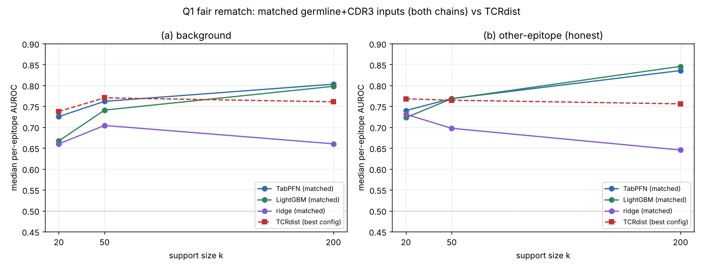
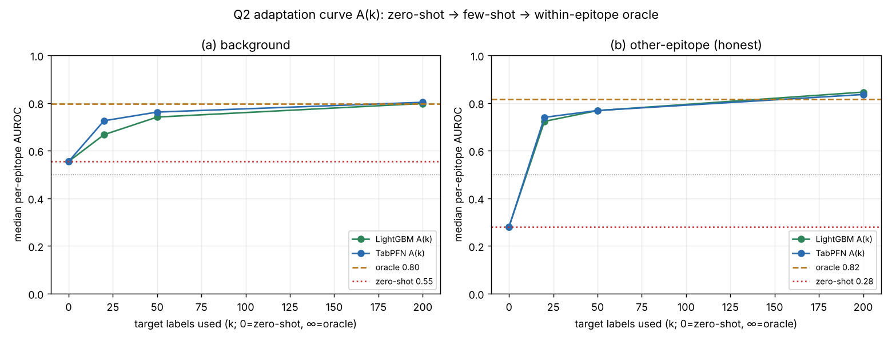

# Fair rematch: matched inputs, headroom, and meta-learnability

**Q1 — does matching the inputs let the tabular models beat TCRdist at k≤50? **Partly.** Matched inputs erase most of the prior deficit: the tabular models reach parity or better by k=50, but TCRdist still wins at k=20. Not a clean negative, not a clean win — TCRdist keeps the edge at the smallest support.** Under honest other-epitope negatives, median per-epitope AUROC at k=20 is LightGBM 0.723 / TabPFN 0.740 vs TCRdist-best 0.768 (Δ LightGBM -0.044); at k=50 LightGBM 0.768 / TabPFN 0.769 vs TCRdist-best 0.765 (Δ LightGBM +0.009). The tabular models only clearly win at k=200. 

Matched inputs = Atchley over germline CDR1/CDR2/CDR2.5 + CDR3 for BOTH chains, from tcrdist3's own germline tables (395 features after dropping constant columns); no V/J target-encoding (the loops already carry the V-gene information TCRdist uses). Splits, clustering (90% identity, cluster-aware), seeds and the per-epitope protocol are identical to the primary study. TCRdist-best is the strongest of beta-only and paired NN/kNN per epitope — notably, **paired TCRdist is weaker than beta-only at k=50** (equal-weighting a noisier alpha chain dilutes the NN distance), so TCRdist is given its best configuration.

## Q1. Matched tabular vs TCRdist (median per-epitope AUROC)

| scheme | k | TabPFN | LightGBM | ridge | TCRdist best | Δ(TabPFN−TD) wins | Δ(LGBM−TD) wins |
| --- | --- | --- | --- | --- | --- | --- | --- |
| (a) background | 20 | 0.725 | 0.667 | 0.660 | 0.738 | -0.033 (4/11) | -0.057 (4/11) |
| (a) background | 50 | 0.762 | 0.741 | 0.704 | 0.770 | -0.020 (5/11) | -0.009 (3/11) |
| (a) background | 200 | 0.803 | 0.798 | 0.660 | 0.761 | +0.008 (3/6) | +0.010 (4/6) |
| (b) other-epitope (honest) | 20 | 0.740 | 0.723 | 0.731 | 0.768 | -0.028 (4/11) | -0.044 (4/11) |
| (b) other-epitope (honest) | 50 | 0.769 | 0.768 | 0.697 | 0.765 | +0.011 (7/11) | +0.009 (6/11) |
| (b) other-epitope (honest) | 200 | 0.836 | 0.846 | 0.645 | 0.756 | +0.026 (6/6) | +0.038 (6/6) |



## Q2. Headroom = oracle − zero-shot, and the adaptation curve A(k)

Oracle = best within-epitope model (LightGBM/ridge) under cluster-aware 5-fold CV on ALL of an epitope's labels. Zero-shot = trained on all other epitopes **with** epitope features, 0 labels from the target. Headroom is the ceiling any in-context head could capture. A(k) is the few-shot curve between them.


**(a) background**

| epitope | zero-shot | A(20) | A(50) | A(200) | oracle | headroom |
| --- | --- | --- | --- | --- | --- | --- |
| ATDALMTGF | 0.589 | 0.635 | 0.769 | — | 0.863 | +0.274 |
| CINGVCWTV | 0.670 | 0.791 | 0.791 | 0.859 | 0.851 | +0.181 |
| GILGFVFTL | 0.487 | 0.794 | 0.833 | 0.860 | 0.880 | +0.393 |
| GLCTLVAML | 0.584 | 0.688 | 0.809 | — | 0.901 | +0.317 |
| KSKRTPMGF | 0.540 | 0.667 | 0.507 | — | 0.738 | +0.198 |
| LLWNGPMAV | 0.555 | 0.692 | 0.793 | 0.816 | 0.857 | +0.302 |
| LTDEMIAQY | 0.498 | 0.574 | 0.588 | — | 0.687 | +0.188 |
| NLVPMVATV | 0.625 | 0.532 | 0.546 | 0.600 | 0.672 | +0.047 |
| SPRWYFYYL | 0.646 | 0.582 | 0.667 | — | 0.797 | +0.151 |
| TTDPSFLGRY | 0.542 | 0.542 | 0.657 | 0.659 | 0.698 | +0.156 |
| YLQPRTFLL | 0.537 | 0.748 | 0.741 | 0.780 | 0.778 | +0.241 |
| **median** | 0.555 | 0.667 | 0.741 | 0.798 | 0.797 | +0.198 |

**(b) other-epitope (honest)**

| epitope | zero-shot | A(20) | A(50) | A(200) | oracle | headroom |
| --- | --- | --- | --- | --- | --- | --- |
| ATDALMTGF | 0.280 | 0.732 | 0.768 | — | 0.895 | +0.614 |
| CINGVCWTV | 0.170 | 0.780 | 0.787 | 0.896 | 0.887 | +0.717 |
| GILGFVFTL | 0.125 | 0.798 | 0.845 | 0.880 | 0.898 | +0.773 |
| GLCTLVAML | 0.176 | 0.750 | 0.806 | — | 0.914 | +0.738 |
| KSKRTPMGF | 0.422 | 0.723 | 0.722 | — | 0.802 | +0.381 |
| LLWNGPMAV | 0.231 | 0.784 | 0.777 | 0.882 | 0.900 | +0.669 |
| LTDEMIAQY | 0.467 | 0.598 | 0.662 | — | 0.717 | +0.250 |
| NLVPMVATV | 0.395 | 0.582 | 0.573 | 0.766 | 0.717 | +0.322 |
| SPRWYFYYL | 0.446 | 0.598 | 0.700 | — | 0.796 | +0.350 |
| TTDPSFLGRY | 0.383 | 0.578 | 0.697 | 0.746 | 0.812 | +0.429 |
| YLQPRTFLL | 0.199 | 0.699 | 0.774 | 0.812 | 0.816 | +0.617 |
| **median** | 0.280 | 0.723 | 0.768 | 0.846 | 0.816 | +0.614 |




Under honest negatives the headroom is large (median +0.614: oracle 0.816 vs zero-shot 0.280, which is **below chance**). But A(k) shows within-task models capture most of it from only a few labels — LightGBM reaches 0.768 by k=50 — so the limiter is not adaptation capacity, it is that target labels are required at all.

## Q3. Is there anything to meta-learn across epitopes?

Per-epitope (oracle, within-epitope CV) median AUROC **0.816**; one pooled model with no epitope conditioning, trained on all other epitopes and applied to the held-out one, median AUROC **0.079** (honest scheme) — far below the per-epitope models, and below chance. Under honest negatives the pooled model *inverts*: the same TCR is a positive for its own epitope and a negative for others, so without epitope conditioning the decision boundary is self-contradictory.


Per-epitope ridge coefficient vectors are essentially **orthogonal** across epitopes: pairwise cosine similarity median -0.014 (range -0.178 to +0.196). The per-task binding functions do not overlap, so there is little shared structure for an in-context head to amortize. Each epitope is its own problem; in-context value here is within-task fitting, not meta-learned transfer.

## Reproduce

```bash
cd tcr_feasibility/code
python annotate_germline.py          # germline loops -> matched cache
python run_experiment.py --feature-mode matched --fresh \
    --out ../results/results_matched.csv   # Q1
python headroom_meta.py                    # Q2 + Q3
python make_report_v2.py
```
